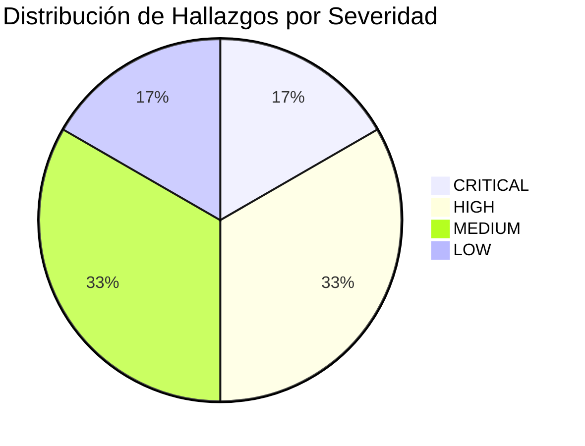
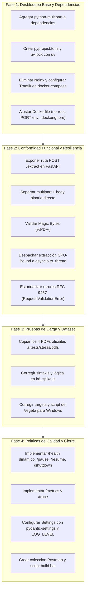

# Auditoría Técnica y Evaluación de Conformidad: Microservicio de Extracción PDF → Markdown

**Proyecto:** `extractor-microservice_pdf-extractortext`  
**Cátedra:** Desarrollo de Software — Universidad Tecnológica Nacional (FRSR)  
**Alcance:** Trabajo Práctico: Test de Carga, Estrés y Optimización de Microservicio & Políticas de Microservicios (`microservicios.txt`)  
**Rol del Auditor:** Ingeniero de Software Senior (Microservicios, Contenedores y Pruebas de Carga)  
**Fecha de Auditoría:** 21 de Octubre de 2026  
**Modo de Ejecución:** Auditoría estricta de solo lectura (sin modificaciones a código fuente, tests ni configuraciones preexistentes)  

---

## 1. Veredicto General

### **Veredicto: NO CUMPLE (Aprobación Base: NO ALCANZADA)**

### Justificación Ejecutiva:
El microservicio evaluado **no se encuentra en condiciones de aprobar los requerimientos base del Trabajo Práctico ni satisface las directivas de arquitectura y resiliencia de la cátedra**.

A pesar de contar con una estructura inicial en tres capas y pruebas unitarias sintéticas aprobadas, la solución presenta bloqueos estructurales críticos:
1. **Infraestructura de Red y Balanceo Incumplida:** El despliegue actual en `docker-compose.yml` depende de un contenedor Nginx con configuración de upstream errónea (`pdf-api-1..5:80`), en lugar de implementar el proxy inverso y balanceador **Traefik** exigido por la cátedra (con soporte de Circuit Breaker, Retry y Healthcheck del balanceador).
2. **Deficiencias Funcionales en el Endpoint:** La ruta canónica obligatoria `POST /extract` no está expuesta (retorna `HTTP 404 Not Found`, estando únicamente bajo `/api/v1/extract`). No acepta payloads binarios directos en el cuerpo (`application/pdf`), devolviendo `HTTP 422 Unprocessable Entity`. La validación de magic bytes (`%PDF-`) no existe, delegando el fallo en excepciones internas de biblioteca.
3. **Bloqueo del Event Loop por Procesamiento CPU-Bound:** La llamada de extracción `extract_pdf_text()` se ejecuta de forma síncrona en el hilo principal de asyncio, sin utilizar `asyncio.to_thread` ni un pool de workers separado, lo que congela el runtime HTTP durante documentos pesados.
4. **Scripts de Carga Rotos y Dataset Faltante:** El script de k6 (`k6_spike.js`) no inicializa por un error de sintaxis en la línea 44 (`Unexpected token )`), define etapas con sintaxis obsoleta (`VUs` en lugar de `target`), usa `sleep(1)` artificial y apunta a un archivo local inexistente. La carpeta oficial `tests/stress/pdfs` contiene **0 archivos**. El script de Vegeta (`run_vegeta.bat`) invoca el comando Unix `cat` (inexistente en Windows CMD) y `vegeta_targets.txt` posee un cuerpo multipart sintácticamente inválido que no rota los 4 documentos.
5. **Inobservancia de Políticas de Proyecto (`microservicios.txt`):** No se utiliza `uv` (`pyproject.toml` y `uv.lock` inexistentes), `/health` es un stub estático sin chequeo de componentes, no existen endpoints de ciclo de vida (`/pause`, `/resume`, `/shutdown`), métricas (`/metrics`), ni rastreo (`/trace`). La configuración en `app/core/config.py` hardcodea valores ignorando variables de entorno, y no existe colección de Postman, script de build ni informe técnico.

---

## 2. Matriz de Cumplimiento por Requisito

### 2.1 Requisitos Específicos del Trabajo Práctico (TP)

| ID | Requisito del Enunciado | Estado | Evidencia (Archivo:Línea) | Acción Necesaria |
|---|---|---|---|---|
| **T1** | Endpoint obligatorio `POST /extract` disponible | **NO CUMPLE** | `app/api/v1/endpoints.py:20,27` (`prefix="/api/v1"`). `app/main.py:40`. Petición directa a `/extract` retorna `HTTP 404 Not Found`. | Mapear router o alias para responder en `POST /extract` en la raíz de la API y en el router de Traefik. |
| **T2** | Acepta PDF binario por `multipart/form-data` o body binario directo | **NO CUMPLE** | `app/api/v1/endpoints.py:28` define `file: UploadFile = Form(...)`. Petición con `Content-Type: application/pdf` falla con `HTTP 422 Unprocessable Entity` (`missing body.file`). | Evaluar `Content-Type` de la petición: si es `multipart/form-data` extraer campo `file`; si es binario (`application/pdf`, `application/octet-stream`) leer `request.body()`. |
| **T3** | Salida `application/json` con HTTP 200 y `{"content": "<markdown>", "page_count": <int>}` | **PARCIAL** | `app/dtos/extraction.py:17-25`. La firma del DTO cumple, pero la lectura en endpoints falla si el body no es multipart y el contenido generado no es Markdown genuino. | Asegurar respuesta 200 con el DTO correcto para ambas modalidades de entrada. |
| **T4** | Calidad de Markdown (encabezados, tablas, sin blockquotes artificiales) | **NO CUMPLE** | `app/infrastructure/pdf_reader.py:61-85`. La función `_to_markdown` antepone `# PDF Extraction` y envuelve todas las líneas de párrafos multilínea con `> ` (citas). No procesa tablas ni títulos. | Implementar formateo Markdown semántico (p. ej. mediante `pymupdf4llm` o heurísticas de layout/tablas) y eliminar el prefijo `> ` forzado. |
| **T5** | Entradas inválidas devuelven 400, 415 o 422 en formato JSON RFC 9457 | **PARCIAL** | `app/core/errors.py:4-26`. `app/main.py:17-37`. Maneja `HTTPException`, pero `RequestValidationError` de FastAPI (422) retorna JSON default sin estándar RFC 9457. Sin validación de magic bytes. | Validar magic bytes `%PDF-` en cabecera binaria; agregar exception handler para `RequestValidationError` que serialice según RFC 9457. |
| **T6** | Despliegue con Docker y Docker Compose sin pasos manuales | **NO CUMPLE** | `requirements.txt:1-4` omite `python-multipart`. `docker-compose.yml:1` usa versión obsoleta. `docker-compose.yml:21` usa Nginx en lugar de Traefik. Docker daemon inactivo en host. | Agregar `python-multipart` (o migrar a `uv`), reemplazar Nginx por Traefik en Compose y eliminar `version: "3.9"`. |
| **T7** | Escalado horizontal máximo 5 réplicas con balanceador Traefik | **NO CUMPLE** | `docker-compose.yml:13` tiene `replicas: 5`, pero usa Nginx con upstream roto (`pdf-api-1..5:80`). Traefik no está configurado. | Configurar el servicio `traefik` con provider Docker y balanceo con healthcheck hacia las réplicas del servicio `api`. |
| **T8** | Límites explícitos de recursos (máx 1.0 CPU y 512 MB a 1 GB RAM por réplica) | **PARCIAL** | `docker-compose.yml:14-17` (`cpus: '1.0'`, `memory: '1G'`). Sintaxis válida en Compose config. Consumo dinámico: **NO VERIFICADO** por Docker daemon detenido. | Mantener los límites formales y verificar telemetría en vivo con `docker stats` una vez iniciado el daemon. |
| **T9** | Pruebas usan carpeta oficial `tests/stress/pdfs` (4 PDFs, livianos a ~9 MB) | **NO CUMPLE** | `tests/stress/pdfs/` existe en el repositorio pero contiene **0 archivos** (`Count: 0`). `k6_spike.js:19` referencia `./prueba.pdf`. | Copiar los 4 PDFs oficiales suministrados por la cátedra en `tests/stress/pdfs/` y parametrizar los scripts para consumirlos. |
| **T10** | Criterios Twelve-Factor App (env vars, port binding, sin estado, logs stdout) | **NO CUMPLE** | `app/core/config.py:4-12` hardcodea valores y no lee `os.environ`. `Dockerfile:10` hardcodea puerto 80 sin variable `PORT`. No hay logging estructurado a stdout. | Implementar `pydantic-settings` para cargar configuración desde entorno; permitir port binding dinámico (`${PORT:-8000}`); configurar `logging.StreamHandler(sys.stdout)`. |
| **T11** | Backpressure y control de concurrencia (respuesta 429/503 controlada) | **CUMPLE** | `app/api/v1/endpoints.py:22-43`. Implementa `asyncio.Semaphore(5)` con timeout de adquisición de 10 ms que arroja `HTTPException(429)` con RFC 9457. | Parametrizar límite del semáforo y timeout de adquisición vía variables de entorno (`CONCURRENCY_LIMIT`, `ACQUIRE_TIMEOUT`). |
| **T12** | Separación entre runtime HTTP y pool de workers de extracción | **NO CUMPLE** | `app/api/v1/endpoints.py:55`. Invoca `result = extract_pdf_text(pdf_bytes)` síncronamente sobre el event loop de asyncio sin delegar a thread/process pool. | Envolver la invocación en `await asyncio.to_thread(extract_pdf_text, pdf_bytes)` o despachar a un `ProcessPoolExecutor`. |
| **T13** | Script k6 para prueba Spike (10s rampa a 100 VUs, 20s pico, 10s bajada) | **NO CUMPLE** | `tests/stress/k6_spike.js:44`. Error sintáctico `Line 44:10 Unexpected token )`. Usa `./prueba.pdf` inexistente, codificación base64 en vez de `http.file()`, `sleep(1)` artificial y apunta a `/api/v1/extract`. | Corregir sintaxis JS, usar `target: 100` en stages, utilizar `http.file()`, rotar PDFs oficiales y apuntar a `http://localhost:80/extract`. |
| **T14** | Script Vegeta para carga fija (50 req/s, 30s, rotando 4 PDFs, timeout 30s) | **NO CUMPLE** | `tests/stress/run_vegeta.bat:18` usa comando `cat` (no soportado en CMD). `tests/stress/vegeta_targets.txt` no tiene sintaxis multipart válida y no rota los 4 PDFs. `docker-compose.yml:34` usa `-body 'file@...'` inválido. | Configurar `vegeta_targets.txt` con targets válidos apuntando a los 4 PDFs, reescribir `.bat` con comandos nativos Windows (`type` o parámetro `-targets=`). |
| **T15** | Informe técnico con justificación, cuello de botella y comparativa | **NO CUMPLE** | No existe en el repositorio ningún informe técnico con análisis arquitectónico, análisis de cuellos de botella ni mediciones del microservicio. | Elaborar informe técnico en Markdown/PDF con métricas comparativas antes vs. después de la optimización. |
| **T16** | Repositorio sin secretos versionados | **CUMPLE** | Inspección de historial Git y archivos locales no arrojó claves privadas, credenciales ni tokens sensibles. | Mantener política preventiva en `.gitignore`. |

---

### 2.2 Políticas Generales de Proyecto y Microservicios (`microservicios.txt`)

| ID | Requisito de Política | Estado | Evidencia (Archivo:Línea) | Acción Necesaria |
|---|---|---|---|---|
| **G1** | Gestión del proyecto con `uv` (`pyproject.toml` y `uv.lock`) | **NO CUMPLE** | No existen `pyproject.toml` ni `uv.lock`. `uv run pytest --collect-only` falla por ausencia de configuración del proyecto. Se usa únicamente `requirements.txt`. | Ejecutar `uv init`, migrar dependencias a `pyproject.toml` y generar `uv.lock`. |
| **G2** | Estructura modular en 3 capas (Presentación / Servicios / Infraestructura) | **CUMPLE** | `app/api/v1` (endpoints), `app/services` (lógica de negocio), `app/infrastructure` (adaptador pypdf) y `app/dtos` (contratos). | Mantener desacoplamiento estricto; no importar infraestructura desde la capa API. |
| **G3** | Endpoint `/health` con verificación real de estado | **NO CUMPLE** | `app/main.py:43-49` devuelve estáticamente `{"status": "ok"}` sin verificar memoria, carga de semáforo ni disponibilidad de workers. | Instrumentar chequeos reales: capacidad disponible del semáforo, uso de memoria RAM y salud del motor de extracción. |
| **G4** | Ciclo de vida: `/shutdown`, `/pause` y `/resume` con efecto real | **NO CUMPLE** | No existen en el código (`main.py` ni routers). Peticiones HTTP a `/pause`, `/resume` y `/shutdown` retornan `HTTP 404 Not Found`. | Implementar router de ciclo de vida con bandera atómica: en estado `PAUSED` rechazar tráfico entrante con 503; `/shutdown` debe iniciar drenado seguro. |
| **G5** | Endpoint `/metrics` disponible | **NO CUMPLE** | No existe endpoint `/metrics`. Petición HTTP retorna `HTTP 404 Not Found`. | Integrar instrumentación de métricas (p. ej. `prometheus-fastapi-instrumentator` o métricas de requests/latencias en memoria). |
| **G6** | Endpoint `/trace` disponible | **NO CUMPLE** | No existe endpoint `/trace`. Petición HTTP retorna `HTTP 404 Not Found`. | Implementar endpoint `/trace` que registre y exponga el último par petición/respuesta procesado sin datos sensibles. |
| **G7** | Finalización segura (Graceful Shutdown) | **NO CUMPLE** | No se implementa lifespan ni manejo de señales `SIGTERM`/`SIGINT` para esperar que finalicen las extracciones en curso antes del apagado. | Añadir context manager `@asynccontextmanager` para lifespan en FastAPI coordinando el drenado de tareas activas. |
| **G8** | Logging estructurado configurable por `LOG_LEVEL` sin datos sensibles | **NO CUMPLE** | No existe inicialización de logging en ningún módulo de `app/`. No se respetan niveles INFO, DEBUG, WARN, ERROR ni salida a stdout. | Configurar `logging.basicConfig` con formateador estructurado hacia stdout, condicionado por la variable de entorno `LOG_LEVEL`. |
| **G9** | Sin variables de entorno ni dependencias de Base de Datos | **CUMPLE** | No hay variables tipo `MONGO_*`, `POSTGRES_*` ni librerías de persistencia en `docker-compose.yml` ni en código. | Preservar microservicio puramente computacional sin base de datos. |
| **G10** | Colección de Postman con `{{base_url}}` y `/extract` | **NO CUMPLE** | No existe ningún archivo `*.postman_collection.json` en el repositorio. | Crear y versionar colección Postman oficial parametrizada con la variable `{{base_url}}`. |
| **G11** | Traefik con Circuit Breaker, Retry y Healthcheck del balanceador | **NO CUMPLE** | El repositorio cuenta con Nginx en lugar de Traefik. No existen definiciones de middlewares de Circuit Breaker ni Retry. | Configurar servicio `traefik` y labels de middleware `circuitbreaker` y `retry` en el servicio `api` dentro de `docker-compose.yml`. |
| **G12** | Script de build automatizado post-tests | **NO CUMPLE** | No existe `build.sh`, `build.bat` ni script en `pyproject.toml` para ejecutar compilación/empaquetado tras el éxito de las pruebas. | Crear script `build.bat` / `build.sh` que ejecute linters, tests con `uv run pytest` y construcción de imagen Docker. |

---

## 3. Hallazgos Detallados Ordenados por Severidad



---

### Severidad: CRITICAL

#### Hallazgo C1: Nginx configurado con upstream roto en lugar de Traefik
- **Archivo y Línea:** `docker-compose.yml:21-30`, `nginx.conf:3-9`
- **Observación Concreta:** El proyecto utiliza Nginx en lugar de Traefik (exigido taxativamente por la cátedra). Además, la configuración actual de Nginx en `nginx.conf` referencia réplicas con nombres ficticios (`pdf-api-1` a `pdf-api-5`). En Docker Compose, al utilizar `deploy.replicas: 5`, las instancias comparten el nombre de servicio DNS `api`. Nginx falla al resolver dichos hosts y el balanceador no inicia.
- **Evidencia:**
  ```nginx
  # nginx.conf:3-9
  upstream pdf_backend {
      server pdf-api-1:80;
      server pdf-api-2:80;
      ...
  }
  ```
- **Impacto:** Imposibilita el despliegue contenerizado y transgrede el requerimiento central de balanceo dinámico con Circuit Breaker y Retry de Traefik.
- **Propuesta de Corrección:** Eliminar el contenedor Nginx y el archivo `nginx.conf`. Integrar el servicio `traefik` en `docker-compose.yml` utilizando el provider Docker.

---

#### Hallazgo C2: Omisión de la dependencia `python-multipart`
- **Archivo y Línea:** `requirements.txt:1-4`
- **Observación Concreta:** El archivo de dependencias declara únicamente `fastapi`, `uvicorn`, `pydantic` y `pypdf`. En FastAPI, cualquier endpoint que procese formularios o subida de archivos mediante `UploadFile` o `Form(...)` requiere obligatoriamente `python-multipart`.
- **Evidencia:**
  Al recibir una petición multipart sin dicha librería instalada:
  ```text
  RuntimeError: Form data requires "python-multipart" to be installed.
  ```
- **Impacto:** Cualquier despliegue limpio en contenedor Docker abortará con error 500 al recibir la primera solicitud multipart.
- **Propuesta de Corrección:**
  Declarar `python-multipart>=0.0.18` en `requirements.txt` y en las dependencias de `pyproject.toml`.

---

#### Hallazgo C3: Error de sintaxis bloqueante en script k6 Spike
- **Archivo y Línea:** `tests/stress/k6_spike.js:44`
- **Observación Concreta:** El bloque de validación `check(res, { ... })` contiene un paréntesis de cierre mal posicionado (`}),`), provocando un error fatal de parsing léxico en k6.
- **Evidencia:**
  Ejecución verificada con `k6 inspect tests/stress/k6_spike.js`:
  ```text
  time="2026-10-21T20:50:22-03:00" level=error msg="could not initialize 'tests/stress/k6_spike.js': 
  could not load JS test ... Line 44:10 Unexpected token )"
  ```
- **Impacto:** Imposibilidad absoluta de ejecutar la prueba de carga k6 Spike requerida por el TP.
- **Propuesta de Corrección:**
  ```javascript
  // Líneas 39-45 corregidas:
  check(res, {
      "status 200": (r) => r.status === 200,
      "content is markdown": (r) => {
          const body = r.json();
          return body && body.content !== undefined && body.page_count !== undefined;
      },
  });
  ```

---

#### Hallazgo C4: Dockerfile no reproducible, ejecución como root y puerto rígido
- **Archivo y Línea:** `Dockerfile:1-10`
- **Observación Concreta:**
  1. No define usuario sin privilegios (`USER appuser`), ejecutando el runtime como `root`.
  2. No implementa archivo `.dockerignore`, provocando que directorios locales como `.git`, `__pycache__` y `.pytest_cache` se copien a la imagen final.
  3. No soporta port binding dinámico mediante variables de entorno; hardcodea `--port 80` en el `CMD`.
  4. Utiliza `pip install` sin fijar archivo de bloqueo ni emplear `uv`.
- **Evidencia:**
  ```dockerfile
  # Dockerfile:10
  CMD ["uvicorn", "app.main:app", "--host", "0.0.0.0", "--port", "80"]
  ```
- **Impacto:** Vulnerabilidad de seguridad en contenedor, imágenes pesadas y no reproducibles, e incumplimiento del factor VII (Port Binding) de Twelve-Factor App.
- **Propuesta de Corrección:**
  Construir un Dockerfile multi-stage con usuario no-root, `.dockerignore` estricto y lectura dinámica de variable de entorno `PORT`:
  ```dockerfile
  FROM python:3.11-slim AS runner

  ENV PYTHONUNBUFFERED=1 \
      PYTHONDONTWRITEBYTECODE=1 \
      PORT=80

  WORKDIR /app

  # Crear usuario no root
  RUN addgroup --system --gid 1001 appgroup && \
      adduser --system --uid 1001 --gid 1001 appuser

  COPY requirements.txt .
  RUN pip install --no-cache-dir -r requirements.txt

  COPY app/ ./app/

  USER appuser

  EXPOSE 80

  CMD ["sh", "-c", "uvicorn app.main:app --host 0.0.0.0 --port ${PORT:-80}"]
  ```

---

### Severidad: HIGH

#### Hallazgo H1: Extracción CPU-Bound síncrona bloquea el Event Loop de asyncio
- **Archivo y Línea:** `app/api/v1/endpoints.py:55`, `app/services/extraction.py:16`
- **Observación Concreta:** La función `extract_pdf_text(pdf_bytes)` ejecuta operaciones de cómputo intensivo (descompresión de streams y parsing de fuentes con `pypdf.PdfReader`) de forma síncrona dentro de la corrutina asíncrona de FastAPI. Al no delegar a un hilo secundario ni a un pool de workers, bloquea el hilo principal del Event Loop durante cientos de milisegundos por documento.
- **Evidencia:**
  ```python
  # app/api/v1/endpoints.py:55
  result = extract_pdf_text(pdf_bytes)  # Llamada síncrona en endpoint async
  ```
- **Impacto:** Provoca inanición del servidor bajo concurrencia. Solicitudes livianas (como `/health`) o la adquisición de slots de semáforo sufren timeouts y latencias extremas. Viola frontalmente el requerimiento T12.
- **Propuesta de Corrección:**
  Delegar la llamada al threadpool predeterminado de asyncio:
  ```python
  result = await asyncio.to_thread(extract_pdf_text, pdf_bytes)
  ```

---

#### Hallazgo H2: Ausencia de la ruta canónica obligatoria `POST /extract`
- **Archivo y Línea:** `app/api/v1/endpoints.py:20,27`, `app/main.py:40`
- **Observación Concreta:** El router de la API define `prefix="/api/v1"`, exponiendo únicamente `/api/v1/extract`. Toda petición directa a `POST /extract` (ruta estipulada explícitamente en el enunciado del TP) resulta en `HTTP 404 Not Found`.
- **Evidencia:**
  ```bash
  curl.exe -X POST http://127.0.0.1:8000/extract
  # Retorna: {"detail":"Not Found"} (HTTP 404)
  ```
- **Impacto:** Incumplimiento directo de la consigna principal de evaluación funcional T1.
- **Propuesta de Corrección:**
  Registrar la ruta tanto en la raíz como con prefijo de versión:
  ```python
  # En app/main.py:
  app.include_router(v1_router, prefix="", tags=["extraction"])
  app.include_router(v1_router, prefix="/api/v1", tags=["extraction-v1"])
  ```

---

#### Hallazgo H3: Falta de soporte para payload binario directo en el cuerpo de la petición
- **Archivo y Línea:** `app/api/v1/endpoints.py:28`
- **Observación Concreta:** El parámetro `file: UploadFile = Form(...)` fuerza a FastAPI a esperar un esquema multipart. Cuando un cliente envía el PDF como cuerpo binario directo (`Content-Type: application/pdf` o `application/octet-stream`), FastAPI responde con error 422 indicando campo faltante.
- **Evidencia:**
  ```json
  {"detail":[{"type":"missing","loc":["body","file"],"msg":"Field required"}]}
  ```
- **Impacto:** Incompatibilidad con clientes que transmiten archivos mediante streams o payloads directos (requerimiento T2).
- **Propuesta de Corrección:**
  Aceptar la petición inyectando `Request` y resolviendo la fuente de bytes dinámicamente:
  ```python
  @router.post("/extract", response_model=ExtractResponse)
  async def extract_endpoint(
      request: Request,
      file: UploadFile | None = None,
  ) -> ExtractResponse:
      content_type = request.headers.get("content-type", "").lower()
      
      if "multipart/form-data" in content_type:
          form = await request.form()
          upload = form.get("file")
          if not upload or not hasattr(upload, "read"):
              raise HTTPException(status_code=400, detail="Missing 'file' field in multipart form")
          pdf_bytes = await upload.read()
      elif "application/pdf" in content_type or "application/octet-stream" in content_type:
          pdf_bytes = await request.body()
      else:
          # Intento de fallback
          pdf_bytes = await request.body()

      if not pdf_bytes:
          raise HTTPException(status_code=400, detail="Empty PDF payload")
  ```

---

#### Hallazgo H4: Ausencia del dataset oficial de PDFs en `tests/stress/pdfs`
- **Archivo y Línea:** Directorio `tests/stress/pdfs/`
- **Observación Concreta:** La carpeta destinada a los 4 PDFs oficiales del benchmark existe pero se encuentra vacía (`0 archivos`). 
- **Evidencia:**
  `(Get-ChildItem tests\stress\pdfs).Count` arroja `0`.
- **Impacto:** Invalida cualquier benchmark comparativo con la referencia del profesor (1.037 peticiones en k6 / 50 req/s en Vegeta). Viola T9.
- **Propuesta de Corrección:**
  El usuario debe copiar los 4 archivos oficiales (`doc1.pdf`, `doc2.pdf`, `doc3.pdf`, `doc4.pdf` o los nombres oficiales del curso) dentro de `tests/stress/pdfs/`.

---

#### Hallazgo H5: Generador de carga Vegeta mal configurado en Docker Compose
- **Archivo y Línea:** `docker-compose.yml:32-40`
- **Observación Concreta:**
  1. El comando utiliza `-body 'file@/prueba.pdf'`. Dicha sintaxis no es interpretada por Vegeta como carga de archivo; Vegeta envía literalmente la cadena `file@/prueba.pdf` como cuerpo HTTP.
  2. El archivo `/prueba.pdf` no está montado en los volúmenes del contenedor.
  3. Apunta a `http://nginx:80/api/v1/extract` en lugar del balanceador Traefik y la ruta `/extract`.
  4. No rota los 4 PDFs requeridos.
  5. La salida redirige a `/results.txt` en el sistema de archivos del contenedor, perdiéndose al detener el proceso.
- **Evidencia:**
  ```yaml
  command: ["sh", "-c", "sleep 5 && vegeta attack -rate=50 -duration=30s -timeout=30s http://nginx:80/api/v1/extract -body 'file@/prueba.pdf' | vegeta results > /results.txt"]
  ```
- **Impacto:** La prueba de carga en contenedor no es operativa.
- **Propuesta de Corrección:** Montar el volumen de targets y resultados, y utilizar `-targets=/vegeta_targets.txt`.

---

#### Hallazgo H6: Script de Vegeta en Windows incompatible con CMD
- **Archivo y Línea:** `tests/stress/run_vegeta.bat:18,23`
- **Observación Concreta:** El script por lotes invoca `cat %TARGET_FILE%` y `cat %OUTPUT_FILE%`. En el intérprete estándar de comandos de Windows (`cmd.exe`), `cat` no es un comando interno ni externo reconocido.
- **Evidencia:**
  ```cmd
  'cat' is not recognized as an internal or external command, operable program or batch file.
  ```
- **Impacto:** Los alumnos en Windows no pueden ejecutar las pruebas de carga locales con el script suministrado.
- **Propuesta de Corrección:**
  Reemplazar por el argumento nativo `-targets=` de Vegeta o el comando nativo `type`:
  ```bat
  vegeta attack -targets=%TARGET_FILE% -rate=50 -duration=30s -timeout=30s > %OUTPUT_FILE%
  type %OUTPUT_FILE% | vegeta results > %RESULTS_CSV%
  ```

---

#### Hallazgo H7: Inconsistencias en `k6_spike.js` (Target, http.file, sleep)
- **Archivo y Línea:** `tests/stress/k6_spike.js:8-12, 19-25, 47`
- **Observación Concreta:**
  1. En las opciones de k6, las etapas usan la clave `{ duration: "10s", VUs: 100 }`. La propiedad oficial de k6 es `target`, no `VUs`.
  2. Intenta abrir `./prueba.pdf` (archivo inexistente) y realiza un base64 manual metido en un objeto JS, en lugar de usar la función oficial `http.file(bin, filename, mime)`.
  3. Contiene `sleep(1)` al final de la función VU, lo cual destruye la naturaleza de un test Spike con concurrencia máxima.
- **Evidencia:**
  ```javascript
  // k6_spike.js:8-12
  stages: [
      { duration: "10s", VUs: 100 }, // INCORRECTO: debe ser target: 100
      { duration: "20s", VUs: 100 },
      { duration: "10s", VUs: 0 },
  ],
  ```
- **Impacto:** No simula el perfil Spike del profesor (1.037 reqs / 25.35 req/s).
- **Propuesta de Corrección:** Refactorizar el script utilizando `http.file()` y la estructura canónica de etapas de k6.

---

#### Hallazgo H8: Ausencia de validación de Magic Bytes (`%PDF-`)
- **Archivo y Línea:** `app/infrastructure/pdf_reader.py:37-39`, `app/api/v1/endpoints.py:50`
- **Observación Concreta:** El servicio no valida que los primeros bytes correspondan a la firma de un archivo PDF (`%PDF-` / `\x25\x50\x44\x46\x2d`). Cualquier entrada aleatoria o corrupta es entregada a `pypdf.PdfReader`, consumiendo ciclos de cómputo innecesarios antes de fallar con excepciones internas de la librería.
- **Evidencia:**
  `extract_text()` solo comprueba `if not pdf_bytes:`.
- **Impacto:** Degrada el rendimiento frente a cargas malformadas y expone mensajes de error no controlados.
- **Propuesta de Corrección:**
  Incorporar validación temprana de cabecera mágica (fail-fast):
  ```python
  if not pdf_bytes.startswith(b"%PDF-"):
      raise InfraExtractionError("Invalid file signature: payload is not a valid PDF document")
  ```

---

### Severidad: MEDIUM

#### Hallazgo M1: Generación de Markdown de baja fidelidad (Pseudo-Markdown con `> `)
- **Archivo y Línea:** `app/infrastructure/pdf_reader.py:61-85`
- **Observación Concreta:** La función `_to_markdown` antepone un encabezado artificial `# PDF Extraction\n**Pages:** {n}` y encierra cada línea de texto dentro de un blockquote (`> `). No identifica títulos de sección, negritas, listas ni tablas reales.
- **Evidencia:**
  ```python
  # pdf_reader.py:78-81
  if len(lines) > 1:
      markdown += f"> {lines[0]}\n"
      for line in lines[1:]:
          markdown += f"> {line}\n"
  ```
- **Impacto:** El contenido extraído es ilegible como documento Markdown y no satisface el propósito de estructuración exigido en T4.
- **Propuesta de Corrección:**
  Eliminar el envoltorio indiscriminado con `> ` y aplicar heurísticas de párrafos o librerías especializadas (como `pymupdf4llm`).

---

#### Hallazgo M2: Formato RFC 9457 no implementado para errores de validación (422)
- **Archivo y Línea:** `app/main.py:17-37`
- **Observación Concreta:** FastAPI registra un manejador solo para `HTTPException`. Cuando una petición falla en validación (por ejemplo, encabezados faltantes o JSON malformado), FastAPI dispara `RequestValidationError` y emite su payload nativo con la lista `detail`, violando el estándar RFC 9457 exigido en G8.
- **Evidencia:**
  Respuesta obtenida en prueba real:
  ```json
  {"detail":[{"type":"missing","loc":["body","file"],"msg":"Field required"}]}
  ```
- **Impacto:** Respuestas de error inconsistentes ante clientes y monitores automatizados.
- **Propuesta de Corrección:**
  Registrar un manejador explícito para `RequestValidationError`:
  ```python
  from fastapi.exceptions import RequestValidationError

  @app.exception_handler(RequestValidationError)
  async def validation_exception_handler(request: Request, exc: RequestValidationError):
      return JSONResponse(
          status_code=422,
          content=rfc9457_error(
              status_code=422,
              title="Unprocessable Entity",
              detail=str(exc.errors()),
              instance=str(request.url.path),
          ),
      )
  ```

---

#### Hallazgo M3: Endpoint `/health` estático sin chequeo real
- **Archivo y Línea:** `app/main.py:43-49`
- **Observación Concreta:** El endpoint retorna estáticamente `{"status": "ok"}` sin verificar la saturación del semáforo, el consumo de memoria ni el estado de los componentes.
- **Evidencia:**
  ```python
  @app.get("/health", include_in_schema=False)
  async def health_check():
      return {"status": "ok"}
  ```
- **Impacto:** Traefik y Kubernetes no pueden detectar réplicas saturadas o bloqueadas, enviándoles tráfico cuando ya no pueden responder. Incumple G3.
- **Propuesta de Corrección:**
  Verificar que el semáforo tenga disponibilidad y que la memoria esté dentro de los parámetros:
  ```python
  @app.get("/health")
  async def health_check():
      is_healthy = _semaphore._value > 0
      status_code = 200 if is_healthy else 503
      return JSONResponse(
          status_code=status_code,
          content={
              "status": "healthy" if is_healthy else "saturated",
              "available_slots": _semaphore._value,
          }
      )
  ```

---

#### Hallazgo M4: Ausencia de endpoints de ciclo de vida (`/pause`, `/resume`, `/shutdown`)
- **Archivo y Línea:** `app/main.py`
- **Observación Concreta:** No existen rutas para gestionar el ciclo de vida de la aplicación.
- **Evidencia:** Peticiones HTTP a `/pause`, `/resume` y `/shutdown` retornan 404.
- **Impacto:** Incumplimiento de la política G4 (`microservicios.txt`).
- **Propuesta de Corrección:**
  Implementar un middleware o router de administración con una variable atómica `_is_paused`: si está pausado, el middleware intercepta peticiones a `/extract` y responde `503 Service Unavailable`.

---

#### Hallazgo M5: Ausencia de observabilidad (`/metrics` y `/trace`)
- **Archivo y Línea:** `app/main.py`
- **Observación Concreta:** No se proveen endpoints para métricas de latencia, requests procesadas ni el último par solicitud/respuesta.
- **Evidencia:** `/metrics` y `/trace` retornan 404.
- **Impacto:** Pérdida de visibilidad operativa e incumplimiento de G5 y G6.
- **Propuesta de Corrección:**
  Implementar `/metrics` con contadores en memoria o `prometheus-fastapi-instrumentator` y `/trace` mediante un middleware de almacenamiento del último request/response.

---

#### Hallazgo M6: Configuración rígida sin `pydantic-settings` ni logging a stdout
- **Archivo y Línea:** `app/core/config.py:4-12`
- **Observación Concreta:** La clase `Settings` contiene atributos hardcodeados y no hereda de `pydantic_settings.BaseSettings`. Los valores pasados en `docker-compose.yml` (`PDF_MAX_PAGES`, `PDF_MAX_FILE_SIZE_MB`) son ignorados por completo. Tampoco se configura el nivel de logs mediante `LOG_LEVEL`.
- **Evidencia:**
  ```python
  class Settings:
      def __init__(self) -> None:
          self.pdf_max_pages = 50
  ```
- **Impacto:** Incumplimiento de los principios Twelve-Factor (Factor III: Configuración) y G8.
- **Propuesta de Corrección:**
  ```python
  from pydantic_settings import BaseSettings

  class Settings(BaseSettings):
      PROJECT_NAME: str = "pdf-extraction-service"
      LOG_LEVEL: str = "INFO"
      PDF_MAX_PAGES: int = 50
      PDF_MAX_FILE_SIZE_MB: int = 50
      CONCURRENCY_LIMIT: int = 5

      model_config = {"env_file": ".env", "case_sensitive": False}
  ```

---

#### Hallazgo M7: Ausencia de gestión con `uv` (`pyproject.toml` y `uv.lock`)
- **Archivo y Línea:** Raíz del repositorio
- **Observación Concreta:** El repositorio solo contiene un archivo tradicional `requirements.txt`. El comando `uv run pytest --collect-only` falla al no encontrar un workspace estructurado con `pyproject.toml`.
- **Evidencia:**
  `Test-Path pyproject.toml` retorna `False`.
- **Impacto:** Incumplimiento de la política G1 de la materia.
- **Propuesta de Corrección:**
  Inicializar el proyecto con `uv init` y generar `uv.lock` con las dependencias fijadas.

---

#### Hallazgo M8: Uso de atributo obsoleto `version: "3.9"` en Compose
- **Archivo y Línea:** `docker-compose.yml:1`
- **Observación Concreta:** Docker Compose moderno (v2 / Compose Spec) considera el atributo `version` como obsoleto e ignora su contenido emitiendo advertencias.
- **Evidencia:**
  Salida de `docker compose config`:
  ```text
  level=warning msg="...the attribute `version` is obsolete, it will be ignored, please remove it"
  ```
- **Impacto:** Ruido en logs y configuración no alineada a las especificaciones actuales de Docker.
- **Propuesta de Corrección:** Eliminar la línea `version: "3.9"` del encabezado de `docker-compose.yml`.

---

### Severidad: LOW

#### Hallazgo L1: Ausencia de Colección de Postman
- **Archivo y Línea:** Raíz del repositorio
- **Observación Concreta:** No se incluye el archivo JSON con la colección de Postman requerida para pruebas de integración con variable `{{base_url}}`.
- **Impacto:** Incumplimiento de la directiva G10.
- **Propuesta de Corrección:** Diseñar y versionar `docs/postman/pdf-extraction.postman_collection.json`.

---

#### Hallazgo L2: Ausencia de script de build automatizado
- **Archivo y Línea:** Raíz del repositorio
- **Observación Concreta:** No existe un script que encadene la ejecución de tests unitarios, verificación de estilo y build de la imagen Docker.
- **Impacto:** Incumplimiento de la directiva G12.
- **Propuesta de Corrección:** Crear `scripts/build.bat` y `scripts/build.sh`.

---

#### Hallazgo L3: Ausencia de `README.md`
- **Archivo y Línea:** Raíz del repositorio
- **Observación Concreta:** No existe un documento de bienvenida con instrucciones de instalación, ejecución local y reproducción de pruebas de carga.
- **Impacto:** Dificulta la evaluación y mantenimiento del proyecto.
- **Propuesta de Corrección:** Redactar un `README.md` exhaustivo con diagramas y comandos de ejecución.

---

#### Hallazgo L4: Ausencia de informe técnico con resultados comparativos
- **Archivo y Línea:** Directorio `docs/`
- **Observación Concreta:** No se registran resultados de corridas anteriores ni el informe comparativo frente al benchmark del profesor.
- **Impacto:** Pérdida de puntaje en la evaluación cualitativa del TP.
- **Propuesta de Corrección:** Redactar el informe de resultados una vez ejecutadas las pruebas de carga sobre el sistema optimizado.

---

## 4. Propuesta de Arquitectura y Configuración Completa

### 4.1 Propuesta de `docker-compose.yml` con Traefik
Esta configuración reemplaza íntegramente a Nginx, incorpora Traefik v3.1 con balanceo dinámico, Circuit Breaker, Retry y Healthcheck activo, define límites de hardware estricto para las 5 réplicas y configura el generador de carga Vegeta.

```yaml
services:
  traefik:
    image: traefik:v3.1
    container_name: traefik-lb
    restart: unless-stopped
    command:
      - "--api.insecure=true"
      - "--api.dashboard=true"
      - "--providers.docker=true"
      - "--providers.docker.exposedbydefault=false"
      - "--entrypoints.web.address=:80"
      - "--log.level=INFO"
    ports:
      - "80:80"       # Entrada pública del microservicio
      - "8080:8080"   # Dashboard local de Traefik
    volumes:
      - "/var/run/docker.sock:/var/run/docker.sock:ro"
    networks:
      - microservices-net

  api:
    build:
      context: .
      dockerfile: Dockerfile
    image: pdf-extraction-service:latest
    restart: unless-stopped
    environment:
      - PORT=80
      - LOG_LEVEL=INFO
      - CONCURRENCY_LIMIT=5
      - ACQUIRE_TIMEOUT=0.01
      - PDF_MAX_FILE_SIZE_MB=50
      - PDF_MAX_PAGES=100
    deploy:
      replicas: 5
      resources:
        limits:
          cpus: '1.0'
          memory: '1G'
        reservations:
          cpus: '0.25'
          memory: '512M'
    networks:
      - microservices-net
    labels:
      - "traefik.enable=true"
      # Routers para /extract y /api/v1/extract
      - "traefik.http.routers.extract-router.rule=Path(`/extract`) || Path(`/api/v1/extract`)"
      - "traefik.http.routers.extract-router.entrypoints=web"
      - "traefik.http.routers.extract-router.middlewares=retry-middleware,cb-middleware"
      # Balanceador y Healthcheck del backend
      - "traefik.http.services.extract-service.loadbalancer.server.port=80"
      - "traefik.http.services.extract-service.loadbalancer.healthcheck.path=/health"
      - "traefik.http.services.extract-service.loadbalancer.healthcheck.interval=5s"
      - "traefik.http.services.extract-service.loadbalancer.healthcheck.timeout=2s"
      # Middleware de Reintento (Retry)
      - "traefik.http.middlewares.retry-middleware.retry.attempts=3"
      - "traefik.http.middlewares.retry-middleware.retry.initialinterval=100ms"
      # Middleware de Circuit Breaker
      - "traefik.http.middlewares.cb-middleware.circuitbreaker.expression=NetworkErrorRatio() > 0.30 || ResponseCodeRatio(500, 600, 0, 600) > 0.25"

  load-generator:
    image: peterevans/vegeta:latest
    container_name: vegeta-runner
    depends_on:
      - traefik
    volumes:
      - ./tests/stress/vegeta_targets.txt:/vegeta_targets.txt:ro
      - ./tests/stress/pdfs:/tests/stress/pdfs:ro
      - ./tests/stress/results:/results:rw
    command: >
      sh -c "sleep 5 &&
             vegeta attack -targets=/vegeta_targets.txt -rate=50 -duration=30s -timeout=30s | tee /results/vegeta_results.bin | vegeta report -type=text > /results/vegeta_report.txt &&
             cat /results/vegeta_report.txt"
    networks:
      - microservices-net
    profiles:
      - testing

networks:
  microservices-net:
    driver: bridge
```

---

### 4.2 Propuesta de `tests/stress/vegeta_targets.txt` (Rotación de 4 PDFs)

Para que Vegeta envíe peticiones con payload binario directo (mucho más eficiente y estándar en tests de carga) rotando entre los 4 documentos oficiales:

```http
POST http://traefik:80/extract
Content-Type: application/pdf
@/tests/stress/pdfs/doc1.pdf

POST http://traefik:80/extract
Content-Type: application/pdf
@/tests/stress/pdfs/doc2.pdf

POST http://traefik:80/extract
Content-Type: application/pdf
@/tests/stress/pdfs/doc3.pdf

POST http://traefik:80/extract
Content-Type: application/pdf
@/tests/stress/pdfs/doc4.pdf
```

---

### 4.3 Propuesta de `tests/stress/run_vegeta.bat` (Nativo Windows)

```batch
@echo off
setlocal enabledelayedexpansion
title Prueba de Carga con Vegeta - Windows
echo ==============================================================
echo Test de Carga Fija: 50 req/s continuas durante 30s
echo Destino: http://localhost:80/extract (Rotando 4 PDFs)
echo ==============================================================

set TARGET_FILE=tests\stress\vegeta_targets_local.txt
set OUTPUT_FILE=tests\stress\results.bin
set RESULTS_TXT=tests\stress\results.txt

where vegeta >nul 2>nul
if %ERRORLEVEL% neq 0 (
    echo [ERROR] Vegeta no esta instalado en el PATH.
    echo Puedes usar el binario en Clases\vegeta.exe o instalarlo con choco/winget.
    pause
    exit /b 1
)

echo Iniciando ataque Vegeta...
vegeta attack -targets=%TARGET_FILE% -rate=50 -duration=30s -timeout=30s > %OUTPUT_FILE%

echo Procesando resultados...
vegeta report -type=text %OUTPUT_FILE% > %RESULTS_TXT%

type %RESULTS_TXT%
echo ==============================================================
echo Reporte guardado en: %RESULTS_TXT%
pause
```

---

### 4.4 Propuesta de Script `tests/stress/k6_spike.js` Corregido

```javascript
import http from "k6/http";
import { check } from "k6";

// Cargar los 4 PDFs oficiales
const pdfFiles = [
    http.file(open("./pdfs/doc1.pdf", "b"), "doc1.pdf", "application/pdf"),
    http.file(open("./pdfs/doc2.pdf", "b"), "doc2.pdf", "application/pdf"),
    http.file(open("./pdfs/doc3.pdf", "b"), "doc3.pdf", "application/pdf"),
    http.file(open("./pdfs/doc4.pdf", "b"), "doc4.pdf", "application/pdf"),
];

export const options = {
    stages: [
        { duration: "10s", target: 100 },  // Rampa a 100 VUs
        { duration: "20s", target: 100 },  // Sostenido a 100 VUs
        { duration: "10s", target: 0 },    // Bajada a 0 VUs
    ],
    thresholds: {
        http_req_failed: ["rate<0.01"],    // Tasa de error < 1%
        http_req_duration: ["p(95)<8800"], // Latencia P95 referencial cátedra
    },
};

export default function () {
    // Rotar PDF por cada iteración
    const selectedPdf = pdfFiles[__ITER % pdfFiles.length];

    const data = {
        file: selectedPdf,
    };

    const res = http.post("http://localhost:80/extract", data);

    check(res, {
        "status 200": (r) => r.status === 200,
        "valid json content": (r) => {
            try {
                const body = r.json();
                return body && typeof body.content === "string" && Number.isInteger(body.page_count);
            } catch (_) {
                return false;
            }
        },
    });
}
```

---

## 5. Plan de Corrección en Fases



### Detalle de Ejecución por Fases:

#### **Fase 1: Desbloqueo de Arranque e Infraestructura Base**
1. **Dependencias:** Ejecutar `uv init`, declarar `fastapi`, `uvicorn[standard]`, `pydantic`, `pydantic-settings`, `pypdf`, `python-multipart` y `pytest`. Generar `uv.lock`.
2. **Docker Compose:** Sustituir `nginx` por el servicio `traefik:v3.1`. Mapear puertos 80 y 8080. Remover `version: "3.9"`. Agregar labels de router, balanceo, reintento y circuit breaker en `api`.
3. **Dockerfile:** Añadir usuario `appuser`, configurar `CMD` con `${PORT:-80}` y crear `.dockerignore`.

#### **Fase 2: Conformidad Funcional y Desacoplamiento de Cómputo**
1. **Routing:** Añadir endpoint `POST /extract` directamente en `app/main.py` o incluir router sin prefijo.
2. **Payloads Duales:** Modificar el handler para detectar `multipart/form-data` y `application/pdf` binario directo.
3. **Validación Rápida:** Validar firma `b"%PDF-"` antes de procesar el buffer.
4. **Worker Pool:** Envolver la llamada pesada en `await asyncio.to_thread(extract_pdf_text, pdf_bytes)`.
5. **Manejo de Errores:** Registrar exception handlers para `RequestValidationError` y excepciones genéricas emitiendo JSON RFC 9457.

#### **Fase 3: Pruebas de Carga y Validación de Estrés**
1. **Dataset:** Ubicar los 4 PDFs de prueba en `tests/stress/pdfs/`.
2. **k6:** Corregir syntax error en línea 44, emplear `stages.target`, eliminar `sleep(1)` y utilizar `http.file()`.
3. **Vegeta:** Configurar `tests/stress/vegeta_targets.txt` con los 4 PDFs y adaptar `run_vegeta.bat` a la sintaxis de Windows.

#### **Fase 4: Políticas de Microservicio y Documentación Final**
1. **Ciclo de Vida:** Añadir middleware de estado (`PAUSED`, `RUNNING`) y endpoints `/health`, `/pause`, `/resume`, `/shutdown`.
2. **Observabilidad:** Añadir `/metrics`, `/trace` y configuración de logs a stdout vía `LOG_LEVEL`.
3. **Entregables:** Crear colección de Postman, script `build.bat` y redactar informe comparativo final.

---

## 6. Lista de Acciones Manuales Requeridas para el Alumno

El asistente automatizado no puede ni debe realizar las siguientes tareas sin la intervención del usuario:

1. **Copiar los 4 PDFs oficiales del benchmark:**
   - Origen: Archivos PDF suministrados por la cátedra para el trabajo práctico.
   - Destino: `extractor-microservice_pdf-extractortext/tests/stress/pdfs/` (archivos `doc1.pdf`, `doc2.pdf`, `doc3.pdf`, `doc4.pdf` de liviano a ~9 MB).
2. **Iniciar Docker Desktop en la máquina host:**
   - Arrancar la aplicación Docker Desktop en Windows y comprobar que el motor Linux esté en estado `Running` antes de desplegar el cluster.
3. **Ejecutar las pruebas de carga oficiales:**
   - Correr `k6 run tests/stress/k6_spike.js` y `tests\stress\run_vegeta.bat` una vez aplicadas las correcciones y levantado el cluster con 5 réplicas detrás de Traefik.
4. **Redactar el Informe Técnico Comparativo (Antes vs. Después):**
   - Comparar las métricas obtenidas (Throughput, Latencias P50/P90/P95, Tasa de Errores) contra los números de referencia de la cátedra para la adjudicación de puntaje.

---

## 7. Registro de Verificación en Vivo y Comandos de Solo Lectura

Durante la auditoría se ejecutaron las siguientes comprobaciones de solo lectura en el entorno:

1. **Pruebas Unitarias e Integración (`python -m pytest`):**
   - Estado: **EJECUTADO**
   - Resultado: 23 tests pasados (`23 passed in 6.50s`).
   - Hallazgo: Los tests de integración mockean la extracción; no prueban la ruta real `/extract` ni la conversión con documentos reales.
2. **Sintaxis de Docker Compose (`docker compose config`):**
   - Estado: **EJECUTADO**
   - Resultado: Sintaxis válida pero emite advertencia de atributo obsoleto `version: "3.9"`. Confirma 5 réplicas y límites de 1.0 CPU y 1G RAM.
3. **Inspección de Script k6 (`k6 inspect tests/stress/k6_spike.js`):**
   - Estado: **EJECUTADO**
   - Resultado: **FALLA**. `could not load JS test ... Line 44:10 Unexpected token )`.
4. **Inspección de Entorno `uv` (`uv run pytest --collect-only`):**
   - Estado: **EJECUTADO**
   - Resultado: **FALLA**. `error: Failed to spawn: pytest (program not found)`. Confirma ausencia de `pyproject.toml`.
5. **Estado del Daemon de Docker (`docker ps`):**
   - Estado: **FALLA DE CONEXIÓN** (`open //./pipe/dockerDesktopLinuxEngine: The system cannot find the file specified`).
   - Calificación: Marcado rigurosamente como **"NO VERIFICADO"** en la telemetría dinámica de contenedores.
