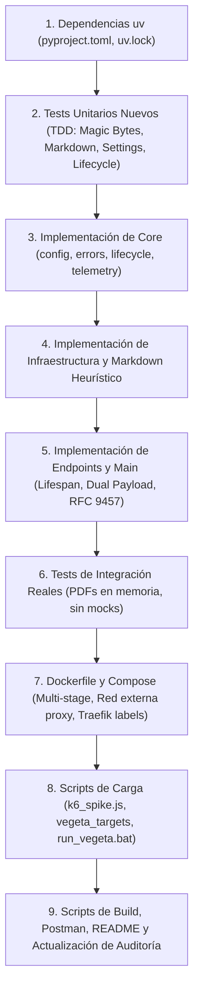

# Plan de Correcciones y Refactorización: Microservicio Extractor (PDF → Markdown)

**Proyecto:** `extractor-microservice_pdf-extractortext`  
**Referencia:** `docs/auditoria.md` y consignas de cátedra  
**Fecha:** 26 de Octubre de 2026  
**Estado:** Propuesta para aprobación del usuario antes de tocar código fuente.

---

## 1. Resumen Ejecutivo y Alcance Arquitectónico

El microservicio Extractor es una pieza computacional sin estado (**Twelve-Factor App**) dentro de una arquitectura mayor. Su único propósito es recibir documentos PDF (vía `multipart/form-data` o stream binario directo) y convertirlos a Markdown estructurado con conteo de páginas.

### Límites de Responsabilidad y Restricciones Estrictas
- **Alcance Aislado:** Este repositorio comprende **únicamente** el microservicio Extractor. No define ni orquesta Traefik, MongoDB, Persistencia ni Frontend.
- **Contrato de Infraestructura:**
  - Red Docker externa: `proxy` (`networks: proxy: {external: true, name: proxy}`).
  - Proxy inverso y balanceador externo: **Traefik**, escuchando en el entrypoint `web` (puerto 80), con `provider.docker=true` y `exposedbydefault=false`.
  - Nginx **no se utiliza** bajo ningún concepto en este microservicio (se elimina de archivos, comentarios, documentación y configuración).
  - Sin persistencia ni variables de base de datos (`G9`).
- **Control del Ciclo de Vida:** El orquestador externo gestiona el orden de arranque y apagado. No se crean scripts de espera ni chequeo de infraestructura externa.
- **Dataset de Benchmarks:** Se respetan los 4 PDFs existentes en `tests/stress/pdfs/` con sus nombres y tamaños originales (`2020-Scrum-Guide-Spanish-Latin-South-American.pdf`, `scrum_manager_historias_usuario.pdf`, `Essential-Kanban-Condensed-Spanish.pdf`, `Filosofia_Lean.pdf`). No se renombran ni se crean PDFs sintéticos para el benchmark.
- **Estado de Ejecución:** Dado que el daemon de Docker Desktop no se encuentra activo en el host de desarrollo, todos los comportamientos que dependen del cluster en vivo (balanceo Traefik, circuit breaker, réplicas activas, métricas bajo carga de Vegeta/k6 en contenedor) quedan catalogados explícitamente como **NO VERIFICADO EN RUNTIME**.

---

## 2. Decisiones Técnicas Clave

### 2.1 Motor de Conversión a Markdown: Comparativa y Justificación

El enunciado solicita eliminar el encabezado fijo `# PDF Extraction` y las citas forzadas `> `, mejorando encabezados, listas y tablas mediante `pymupdf4llm` o heurística documentada:

| Criterio | Opción A: `pymupdf4llm` (PyMuPDF) | Opción B: Heurística Estructural sobre `pypdf` (Recomendada) |
|---|---|---|
| **Licencia** | **AGPL-3.0** (Copyleft estricto o licencia comercial paga de Artifex). Riesgo de contaminación legal en microservicios cerrados. | **BSD-3-Clause** (Completamente permisiva, estándar de la industria). |
| **Peso en Imagen** | **Alto** (+35 MB a 50 MB de wheels y librerías C compartidas de MuPDF). | **Nulo** (0 MB adicionales; reutiliza `pypdf` ya presente en el proyecto). |
| **Rendimiento** | Rápido en C, pero mayor huella de memoria por worker. | Mínimo consumo de RAM, ideal para límite de 1 GB en 5 réplicas. |
| **Estructuración** | Genera tablas Markdown y detecta fuentes automáticamente. | Heurística documentada: detecta títulos mediante patrones/mayúsculas/longitud, listas con viñetas (`•`, `-`, `*`, números) y tablas mediante separación columnar de espacios múltiples. |

> **Decisión:** Implementar la **Opción B (Heurística documentada sobre `pypdf`)** como solución primaria, preservando la licencia permisiva BSD y minimizando la huella de memoria del contenedor (filosofía *Ponytail / YAGNI*). Se deja la interfaz del adaptador `pdf_reader.py` completamente modular para intercambiar el motor si la cátedra exigiera explícitamente `pymupdf4llm`.

### 2.2 Middlewares Traefik y Umbrales de Circuit Breaker

- **Router Público:** `traefik.http.routers.extractor.rule=Path('/extract') || Path('/api/v1/extract')`
- **Entrypoint:** `web`
- **Balanceador:** `traefik.http.services.extractor.loadbalancer.server.port=80`
- **Healthcheck:** `traefik.http.services.extractor.loadbalancer.healthcheck.path=/health`, `interval=5s`, `timeout=2s`
- **Retry Middleware:** `traefik.http.middlewares.retry-extractor.retry.attempts=3`, `initialinterval=100ms`
- **Circuit Breaker Middleware:**  
  `traefik.http.middlewares.cb-extractor.circuitbreaker.expression=NetworkErrorRatio() > 0.30 || ResponseCodeRatio(500, 600, 0, 600) > 0.25`  
  *Estado:* **Propuesta técnica a validar con la cátedra** y **NO VERIFICADO EN RUNTIME** (requiere Traefik en ejecución). Se incluirá una nota explícita en el README indicando que estos umbrales son parametrizables según las directivas finales de la cátedra.
- **Aislamiento de Rutas Administrativas:**  
  Las rutas `/pause`, `/resume`, `/shutdown`, `/metrics` y `/trace` no se exponen en el router público `extractor` de Traefik. Son rutas exclusivas para comunicación interna del Orquestador y monitoreo dentro de la red `proxy`. Opcionalmente se declara un router `extractor-admin` restringido por IP middleware (`ipAllowList`) para la subred interna del proxy.

### 2.3 Observabilidad y Ciclo de Vida Ligero (In-Memory)

- **Telemetría (`/metrics` y `/trace`):** Implementada en memoria en `app/core/telemetry.py` sin sobrecostos de librerías externas. Registra total de requests, errores discriminados por código HTTP, percentiles/promedio de latencia, y el último par request/response excluyendo datos sensibles y el body binario.
- **Ciclo de Vida (`/pause`, `/resume`, `/shutdown`):** Implementado con máquina de estados (`RUNNING`, `PAUSED`, `SHUTTING_DOWN`) y contador atómico de extracciones activas. En `PAUSED`, `/extract` retorna `503 Service Unavailable` RFC 9457 de inmediato. `/shutdown` drena peticiones activas antes de invocar la terminación limpia en el lifespan de FastAPI.

### 2.4 Versión Fijada de UV en Dockerfile

Para garantizar reproducibilidad absoluta en la construcción multi-stage de la imagen Docker:
- Se utiliza la imagen oficial fijada: `ghcr.io/astral-sh/uv:0.11.4` (coincidente con la versión instalada en el entorno local).
- No se utilizará la etiqueta `latest`.

### 2.5 Rutas de Dataset en Pruebas de Carga (Vegeta)

- En `docker-compose.yml`, el volumen del dataset para `load-generator` se monta en `/pdfs`: `./tests/stress/pdfs:/pdfs:ro`.
- En `tests/stress/vegeta_targets.txt`, los targets referencian `@/pdfs/<nombre-del-archivo>.pdf`.
- En `tests/stress/vegeta_targets_local.txt`, se utiliza la ruta relativa desde la raíz del repositorio (`@tests/stress/pdfs/<nombre-del-archivo>.pdf`) y se documenta en el archivo y en el README.

---

## 3. Plan de Cambios Detallado por Archivo

### Archivos a Eliminar
1. **`nginx.conf`**: Eliminación total. No se utiliza Nginx en la arquitectura con Traefik.
2. **`requirements.txt`**: Eliminación tras migrar el empaquetado y gestión de dependencias a `uv` (`pyproject.toml` y `uv.lock`).

---

### Archivos a Crear

#### 1. `pyproject.toml`
- Configuración de empaquetado con `hatchling` o `flit` vía `uv`.
- **Dependencias principales:** `fastapi>=0.104.1`, `uvicorn[standard]>=0.27.0`, `pydantic>=2.8.0`, `pydantic-settings>=2.0.0`, `pypdf>=3.1.0`, `python-multipart>=0.0.18`.
- **Dependencias de desarrollo:** `pytest>=8.0.0`, `httpx>=0.27.0`.

#### 2. `uv.lock`
- Archivo de bloqueo reproducible generado automáticamente con `uv lock`.

#### 3. `.dockerignore`
- Exclusiones estrictas para optimizar el contexto de build:
  ```text
  .git
  .venv
  __pycache__
  *.pyc
  .pytest_cache
  .ruff_cache
  tests/stress/results
  docs
  *.md
  ```

#### 4. `app/core/lifecycle.py`
- Módulo de ciclo de vida con estados: `RUNNING`, `PAUSED`, `SHUTTING_DOWN`.
- Primitivas de sincronización para contar peticiones en vuelo (`in_flight_counter`) y permitir graceful shutdown.
- Funciones para consultar y transicionar estado: `pause_service()`, `resume_service()`, `shutdown_service()`, `get_state()`.

#### 5. `app/core/telemetry.py`
- Módulo de observabilidad en memoria:
  - Registro de solicitudes: contadores de estado HTTP (200, 400, 413, 415, 422, 429, 500, 503).
  - Tiempos de respuesta (acumulado, conteo, mín, máx).
  - Buffer circular/variable para el último `trace` (método, ruta, status, duración en ms, timestamp, headers sanitizados, **sin el contenido binario del PDF**).

#### 6. `tests/unit/test_lifecycle.py`
- Pruebas unitarias de la máquina de estados: transiciones válidas, rechazo o pausa de peticiones, drenado de tareas activas.

#### 7. `tests/unit/test_magic_bytes.py`
- Validación de magic bytes `%PDF-`: archivos válidos, texto plano, imágenes corruptas y rechazo temprano con error RFC 9457.

#### 8. `tests/unit/test_markdown.py`
- Pruebas de la heurística de Markdown:
  - Ausencia total del prefijo `> ` y del título `# PDF Extraction`.
  - Detección de títulos de sección (`#`, `##`).
  - Detección de listas con viñetas.
  - Tablas básicas formateadas con columnas Markdown (`|`).

#### 9. `tests/stress/vegeta_targets_local.txt`
- Targets de Vegeta apuntando a `http://localhost:80/extract` para ejecución nativa desde el host con `run_vegeta.bat`.

#### 10. `tests/stress/pdfs/README.md`
- Documentación del dataset oficial presente en la carpeta:
  1. `2020-Scrum-Guide-Spanish-Latin-South-American.pdf` (~319 KB)
  2. `Filosofia_Lean.pdf` (~668 KB)
  3. `scrum_manager_historias_usuario.pdf` (~3.8 MB)
  4. `Essential-Kanban-Condensed-Spanish.pdf` (~8.9 MB)

#### 11. `scripts/build.ps1` y `scripts/build.sh`
- Automatización de validación:
  1. Ejecución de `uv run pytest`.
  2. Solo si las pruebas pasan exitosamente, ejecución condicional de `docker compose build`.

#### 12. `docs/postman/pdf-extraction.postman_collection.json`
- Colección de Postman parametrizada con `{{base_url}}`:
  - `POST /extract` con `multipart/form-data` (campo `file` de tipo File).
  - `POST /extract` con body binario (`application/pdf`).
  - `GET /health`.
  - `POST /pause` y `POST /resume`.
  - `POST /shutdown`.
  - `GET /metrics`.
  - `GET /trace`.

---

### Archivos a Modificar

#### 1. `docker-compose.yml`
- Eliminar `version: "3.9"` (obsoleto).
- Eliminar servicio `nginx` y cualquier referencia al mismo.
- Declarar red externa: `networks: proxy: { external: true, name: proxy }`.
- Configurar servicio `api`:
  - `deploy.replicas: 5`.
  - `resources.limits`: `cpus: '1.0'`, `memory: 1G`.
  - Sin `container_name` ni mapeo directo de `ports`.
  - `expose: ["80"]`.
  - Red: `proxy`.
  - Variables de entorno: `PORT=80`, `LOG_LEVEL=INFO`, `CONCURRENCY_LIMIT=5`, `ACQUIRE_TIMEOUT=0.01`, `PDF_MAX_FILE_SIZE_MB=50`, `PDF_MAX_PAGES=100`.
  - Labels Traefik completas (entrypoint `web`, router `/extract` y `/api/v1/extract`, retry x3, circuit breaker, healthcheck cada 5s).
- Configurar servicio `load-generator`:
  - Bajo perfil `testing` (`profiles: [testing]`).
  - Conectado a red `proxy`.
  - Volúmenes para targets, pdfs y results.
  - Comando sin `cat`: `vegeta attack -targets=/vegeta_targets.txt -rate=50 -duration=30s -timeout=30s | vegeta report -type=text > /results/vegeta_report.txt`.

#### 2. `Dockerfile`
- Multi-stage build utilizando `ghcr.io/astral-sh/uv` o instalación eficiente de `uv`:
  - Stage de dependencias / build con `uv sync --frozen --no-dev`.
  - Stage final con imagen limpia `python:3.11-slim`.
  - Usuario no root `appuser` (UID 1001, GID 1001).
  - Variables de entorno: `PYTHONUNBUFFERED=1`, `PYTHONDONTWRITEBYTECODE=1`, `PORT=80`.
  - `EXPOSE 80`.
  - `CMD ["sh", "-c", "uvicorn app.main:app --host 0.0.0.0 --port ${PORT}"]`.

#### 3. `app/core/config.py`
- Refactorizar clase `Settings` heredando de `pydantic_settings.BaseSettings`:
  - `PORT: int = 80`
  - `LOG_LEVEL: str = "INFO"`
  - `CONCURRENCY_LIMIT: int = 5`
  - `ACQUIRE_TIMEOUT: float = 0.01`
  - `PDF_MAX_FILE_SIZE_MB: int = 50`
  - `PDF_MAX_PAGES: int = 100`
  - Sin valores hardcodeados en módulos de negocio.

#### 4. `app/core/errors.py`
- Estandarización de errores HTTP en formato RFC 9457 `Problem Details`:
  - Campos: `type`, `title`, `status`, `detail`, `instance`.
  - Clases de excepción de dominio:
    - `InvalidPDFError` (400)
    - `UnsupportedMediaTypeError` (415)
    - `PayloadTooLargeError` (413)
    - `UnprocessablePDFError` (422)
    - `ServicePausedError` (503)
    - `ConcurrencyLimitError` (429)

#### 5. `app/infrastructure/pdf_reader.py`
- Validación de Magic Bytes `pdf_bytes.startswith(b"%PDF-")`.
- Validación de límites de tamaño y páginas configurados en `Settings`.
- Extracción de texto y conversión a Markdown estructurado:
  - Supresión de `# PDF Extraction` y de los blockquotes `> ` en párrafos.
  - Formateo de títulos basados en jerarquía y mayúsculas.
  - Formateo de listas con viñetas.
  - Detección de alineaciones tabulares básicas.

#### 6. `app/services/extraction.py`
- Orquestación pura: recibe bytes y coordina la llamada a la capa de infraestructura.
- Manejo de excepciones de dominio y retorno de `ExtractResponse(content=..., page_count=...)`.
- Libre de dependencias de FastAPI o Starlette.

#### 7. `app/api/v1/endpoints.py`
- Implementación de ruta unificada `POST /extract` con alias `/api/v1/extract`.
- Detección dinámica de entrada según `Content-Type`:
  - Si contiene `multipart/form-data`: `form = await request.form()`, extracción del campo `file` y lectura `await file.read()`.
  - Si es `application/pdf` o `application/octet-stream`: lectura directa `await request.body()`.
  - Cualquier otro tipo: lanza `415 Unsupported Media Type` en formato RFC 9457.
- Validación de control de concurrencia mediante `asyncio.Semaphore` con timeout no bloqueante (`ACQUIRE_TIMEOUT`). Si satura -> `429 Too Many Requests` (RFC 9457).
- Verificación de estado del ciclo de vida (`PAUSED` o `SHUTTING_DOWN` -> `503 Service Unavailable` RFC 9457).
- Despacho CPU-bound seguro: `result = await asyncio.to_thread(extract_pdf_text, pdf_bytes)`.
- Registro de telemetría de la petición y duración en `app.core.telemetry`.

#### 8. `app/main.py`
- Inicialización de logging a `sys.stdout` con nivel configurable según `settings.LOG_LEVEL`. Prohibición absoluta de loguear contenido o texto de PDFs.
- Lifespan context manager (`@asynccontextmanager`) para coordinar el arranque y drenado seguro de peticiones (Graceful Shutdown).
- Exception handlers globales que transforman toda excepción a RFC 9457:
  - `HTTPException`
  - `RequestValidationError` (convierte el formato nativo 422 de FastAPI a RFC 9457 con `title: "Unprocessable Entity"`)
  - Excepciones de dominio
  - `Exception` general (retorna 500 RFC 9457 sin exponer stack trace interno)
- Endpoints administrativos y de observabilidad:
  - `GET /health`: retorna 200 con `status: "healthy"` y `available_slots: N` si el estado es `RUNNING` y hay slots disponibles; retorna 503 si está pausado, apagándose o sin slots.
  - `POST /pause` y `POST /resume`: cambian el estado en memoria.
  - `POST /shutdown`: inicia drenado y apagado controlado.
  - `GET /metrics`: expone contadores de peticiones, errores por código y latencias.
  - `GET /trace`: expone último par request/response (sin body binario).

#### 9. `tests/integration/test_endpoints.py`
- **Eliminación de todo mock en la ruta principal de extracción.**
- Creación de PDFs válidos mínimos en memoria (utilizando `pypdf.PdfWriter`) para probar el flujo real `endpoint → servicio → infraestructura`.
- Pruebas de integración para:
  - `POST /extract` con `multipart/form-data`.
  - `POST /extract` con cuerpo binario `application/pdf`.
  - `POST /api/v1/extract` (compatibilidad de alias).
  - Rechazo de Content-Type no soportado (415 RFC 9457).
  - Rechazo de archivo sin magic bytes `%PDF-` (400 RFC 9457).
  - Endpoints `/health`, `/pause`, `/resume`, `/shutdown`, `/metrics`, `/trace`.

#### 10. `tests/unit/test_core.py`, `test_infrastructure.py`, `test_services.py`
- Actualización para verificar `Settings(BaseSettings)`, magic bytes, heurística de Markdown y excepciones de dominio.

#### 11. `tests/stress/k6_spike.js`
- Corrección del error de sintaxis en la línea 44 (`Line 44:10 Unexpected token )`).
- Reemplazo de propiedad obsoleta `VUs` por `target` en `stages` ({ duration: "10s", target: 100 }, etc.).
- Uso de `http.file(open("./pdfs/...", "b"), ...)` con los 4 nombres reales de archivos PDF.
- Rotación por iteración (`__ITER % pdfFiles.length`).
- Destino de petición: `http://localhost:80/extract`.
- Eliminación de `sleep(1)`.
- Verificación con `k6 inspect tests/stress/k6_spike.js`.

#### 12. `tests/stress/vegeta_targets.txt`
- Configuración con sintaxis válida de Vegeta para los 4 PDFs rotativos, apuntando a `http://traefik:80/extract` dentro de la red Docker `proxy`:
  ```http
  POST http://traefik:80/extract
  Content-Type: application/pdf
  @/tests/stress/pdfs/2020-Scrum-Guide-Spanish-Latin-South-American.pdf

  POST http://traefik:80/extract
  Content-Type: application/pdf
  @/tests/stress/pdfs/scrum_manager_historias_usuario.pdf

  POST http://traefik:80/extract
  Content-Type: application/pdf
  @/tests/stress/pdfs/Essential-Kanban-Condensed-Spanish.pdf

  POST http://traefik:80/extract
  Content-Type: application/pdf
  @/tests/stress/pdfs/Filosofia_Lean.pdf
  ```

#### 13. `tests/stress/run_vegeta.bat`
- Script nativo de Windows (sin comando Unix `cat`).
- Utiliza `vegeta attack -targets=%TARGET_FILE% ...` y `vegeta report -type=text`.

#### 14. `README.md`
- Redacción integral con:
  - Prerrequisitos (red externa `proxy` preexistente).
  - Instalación y gestión con `uv`.
  - Ejecución de tests (`uv run pytest`).
  - Despliegue con Docker Compose (5 réplicas detrás de Traefik).
  - Ejecución de pruebas de carga con k6 y Vegeta.
  - Referencia de endpoints y códigos de error RFC 9457.
  - Cero menciones de Nginx en todo el texto.

#### 15. `docs/auditoria.md`
- Actualización de la matriz de conformidad marcando cada hallazgo como **RESUELTO**, **PARCIAL** o **NO VERIFICADO EN RUNTIME** con su respectiva evidencia técnica.
- Eliminación de referencias a Nginx para que `grep -ri nginx .` arroje 0 resultados.

---

## 4. Orden de Implementación Paso a Paso (TDD)



---

## 5. Criterios de Aceptación y Validación Prevista

1. `uv run pytest` pasa al 100% sin warnings de corrutinas ni mocks en el camino crítico.
2. `docker compose config` es válido sin warnings de versión ni sintaxis.
3. `grep -ri nginx .` retorna 0 coincidencias en todo el repositorio.
4. `grep -ri mongo .` retorna 0 coincidencias en el código del microservicio.
5. `k6 inspect tests/stress/k6_spike.js` valida sin errores léxicos ni de sintaxis.
6. Lo dependiente de Docker Desktop se marca como **NO VERIFICADO EN RUNTIME** con instrucciones claras para el usuario.
