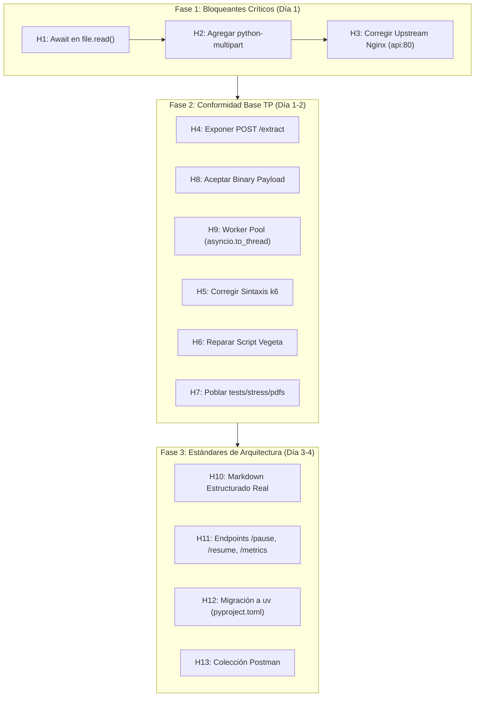

# Informe de Verificación Técnica: Microservicio de Extracción PDF → Markdown

**Materia:** Desarrollo de Software (UTN FRSR)  
**Proyecto:** Trabajo Práctico: Test de Carga, Estrés y Optimización de Microservicio  
**Rol del evaluador:** Revisor técnico independiente  
**Fecha de evaluación:** 21 de Octubre de 2026  
**Repositorio evaluado:** `C:\Users\lauta\OneDrive\Escritorio\Facultad\Tercer_Ano\Desarrollo de Software\extractor-microservice_pdf-extractortext`  

---

## 1. Veredicto General

### **Veredicto: NO CUMPLE (Aprobación Base: NO ALCANZADA)**

El microservicio evaluado **no cumple con los requisitos mínimos para la aprobación base del Trabajo Práctico** ni con los estándares de arquitectura solicitados en las consideraciones generales de la cátedra. 

A pesar de contar con una estructura en capas inicial y declarar formalmente 5 réplicas con límites de recursos en `docker-compose.yml`, el sistema presenta bloqueos críticos tanto a nivel de código fuente como de infraestructura de contenedores y pruebas de carga:

1. **Fallo funcional total en extracción (T3):** En tiempo de ejecución, el 100% de las solicitudes de extracción válidas fallan con código `HTTP 400 Bad Request`. La causa raíz es un error crítico en `app/api/v1/endpoints.py` (línea 50) donde se invoca `file.read()` y `asyncio.wait_for(...)` sin la instrucción `await`, pasando un objeto corrutina a `io.BytesIO()` dentro de la capa de infraestructura, lo que detona un `TypeError` no controlado.
2. **Incompatibilidad de endpoints y payloads (T1, T2):** El endpoint obligatorio `POST /extract` no existe (devuelve `HTTP 404 Not Found`), estando registrado únicamente como `/api/v1/extract`. Asimismo, no acepta payloads binarios directos en el body (devuelve `HTTP 422 Unprocessable Entity`), aceptando exclusivamente `multipart/form-data`.
3. **Imposibilidad de despliegue contenerizado automático (T6):** El comando `docker compose up --build` falla debido a:
   - Ausencia de la dependencia `python-multipart` en `requirements.txt`, lo que impide que FastAPI inicie en el contenedor Docker.
   - Configuración inválida de upstream en `nginx.conf` (`pdf-api-1..5:80`), nombres que Docker DNS no resuelve al escalar el servicio `api`.
4. **Scripts de carga rotos y ausencia de dataset oficial (T9, T13, T14):**
   - La carpeta oficial `tests/stress/pdfs` existe pero contiene **0 archivos**.
   - El script de k6 (`k6_spike.js`) no compila debido a un error de sintaxis en la línea 44 (`Line 44:10 Unexpected token )`).
   - El script de Vegeta (`run_vegeta.bat`) no rota los 4 PDFs oficiales, contiene una sintaxis de payload multipart errónea en `vegeta_targets.txt` y hace uso del comando Unix `cat`.
5. **Calidad de conversión y concurrencia (T4, T12):** El campo `content` no extrae tablas ni jerarquías de títulos reales, limitándose a envolver párrafos de texto plano de `pypdf` en blockquotes (`> `). Además, no existe separación entre el runtime HTTP y la extracción (T12); la extracción CPU-bound se ejecuta de forma síncrona en el hilo principal del Event Loop de asyncio, bloqueando el servidor bajo concurrencia.

---

## 2. Tabla de Cumplimiento

### Parte 1: Consignas del Trabajo Práctico (TP)

| ID | Requisito | Estado | Evidencia | Acción Necesaria |
|---|---|---|---|---|
| **T1** | Endpoint `POST /extract` disponible | **NO CUMPLE** | `app/api/v1/endpoints.py:20,27` (`prefix="/api/v1"`). `curl -X POST http://localhost:8000/extract` devuelve `404 Not Found`. `nginx.conf:15` solo rutea `/api/v1/extract`. | Exponer la ruta en `/extract` en `app/main.py` o redirigir/incluir sin prefijo, y configurar Nginx/Traefik para dicho path. |
| **T2** | Acepta `multipart/form-data` y binario directo en body | **NO CUMPLE** | `app/api/v1/endpoints.py:28` solo tipa `file: UploadFile = Form(...)`. Petición binaria directa con `Content-Type: application/pdf` devuelve `422 Unprocessable Entity` (`missing body.file`). | Inspeccionar encabezado `Content-Type`; si es `application/pdf` o binario, leer `request.body()`; si es multipart, leer `UploadFile`. |
| **T3** | Respuesta 200 OK con JSON `content` y `page_count` real | **NO CUMPLE** | `app/api/v1/endpoints.py:50`: `asyncio.wait_for(file.read(), timeout=30.0)` sin `await`. Petición real devuelve `400 Bad Request`: `TypeError: a bytes-like object is required, not 'coroutine'`. | Agregar `await` a `file.read()` y a `asyncio.wait_for(...)`. |
| **T4** | `content` es Markdown estructurado (encabezados, tablas) | **PARCIAL** | `app/infrastructure/pdf_reader.py:61-85`: solo antepone `# PDF Extraction` y prefijos `> ` a cada línea de texto plano de `pypdf`. No extrae tablas ni títulos reales del documento. | Incorporar librería orientada a Markdown o procesamiento semántico (p. ej. `pymupdf4llm` o heurísticas de formato). |
| **T5** | Entradas inválidas devuelven 400, 415 o 422 en formato JSON | **PARCIAL** | Archivo no PDF devuelve 400 y vacío devuelve 422. Sin embargo, el 400 proviene del fallo de corrutina enmascarado y no de validación de Magic Bytes o MIME type. Error 422 devuelve formato FastAPI nativo, no RFC 9457. | Añadir validación explícita de Magic Bytes (`%PDF-`), MIME header y un handler para `RequestValidationError` con RFC 9457. |
| **T6** | Dockerfile y compose listos; `docker compose up --build` sin pasos manuales | **NO CUMPLE** | 1) `requirements.txt` no incluye `python-multipart` (crashea FastAPI). 2) `nginx.conf:4-8` usa nombres upstream inexistentes (`pdf-api-1..5`). 3) Docker daemon detenido en host. | Agregar `python-multipart` a `requirements.txt`, corregir upstream en Nginx (`server api:80;`), e iniciar el daemon de Docker. |
| **T7** | Escalado horizontal máximo 5 réplicas con proxy/balanceador | **PARCIAL** | `docker-compose.yml:13` define `deploy.replicas: 5`. Sin embargo, `nginx.conf` tiene upstream roto y no utiliza Traefik/Caddy. | Configurar balanceador inverso funcional apuntando al servicio escalable de Docker. |
| **T8** | Límites explícitos de recursos (≤1.0 CPU, 512MB-1GB RAM) | **PARCIAL** | `docker-compose.yml:14-17` y `docker compose config` confirman `cpus: 1.0` y `memory: 1G`. `docker stats` no verificable en vivo por daemon detenido. | Validar métricas de consumo en caliente con `docker stats` una vez levantado el entorno. |
| **T9** | Pruebas usan carpeta `tests/stress/pdfs` intacta | **NO CUMPLE** | La carpeta `tests/stress/pdfs` existe pero tiene 0 archivos. `k6_spike.js` usa `./prueba.pdf` y `vegeta_targets.txt` usa `file=@prueba.pdf`. | Incorporar los 4 PDFs oficiales del benchmark en `tests/stress/pdfs/` y consumirlos desde los scripts. |
| **T10** | Twelve-Factor App (env vars, port binding, sin estado, logs) | **PARCIAL** | Port binding y sin estado cumplen. Pero `app/core/config.py` hardcodea valores y no lee `os.environ`. No existe configuración de logs a stdout. | Utilizar `pydantic-settings` para cargar variables de entorno y configurar logging en consola. |
| **T11** | Backpressure con concurrencia acotada y respuesta 429/503 | **CUMPLE** | `app/api/v1/endpoints.py:23-43` usa `asyncio.Semaphore(5)` con timeout de adquisición de 10ms y lanza `HTTPException(429)` con RFC 9457 Problem Details. | Parametrizar el límite de concurrencia y timeout de adquisición vía variables de entorno. |
| **T12** | Separación entre runtime HTTP y pool de workers de extracción | **NO CUMPLE** | `app/api/v1/endpoints.py:55` llama síncronamente `extract_pdf_text(pdf_bytes)` sobre el hilo principal de asyncio. No hay `asyncio.to_thread` ni worker pool. | Ejecutar extracción CPU-bound en threadpool (`await asyncio.to_thread(...)`) o `ProcessPoolExecutor`. |
| **T13** | Script k6 para test Spike (10s subida 100 VUs, 20s pico, 10s bajada) | **NO CUMPLE** | `tests/stress/k6_spike.js` define las etapas requeridas, pero falla con error sintáctico en línea 44 (`Line 44:10 Unexpected token )`). Apunta a `./prueba.pdf` inexistente y a `/api/v1/extract`. | Corregir sintaxis JS, usar `http.file()`, apuntar a `/extract` y eliminar `sleep(1)` para prueba de pico. |
| **T14** | Script Vegeta para carga fija (50 req/s, 30s, rotando 4 PDFs, timeout 30s) | **NO CUMPLE** | `tests/stress/run_vegeta.bat` no rota 4 PDFs (solo 1 target), formato multipart inválido en `vegeta_targets.txt`, usa `cat` (no Windows) y Vegeta no está instalado en host. | Generar targets válidos para Vegeta con los 4 PDFs rotativos y corregir ruta a `/extract`. |
| **T15** | Informe técnico con justificación, cuello de botella y comparativa | **NO CUMPLE** | No existe ningún informe técnico ni archivo de documentación de resultados en el repositorio. | Redactar informe técnico completo con análisis arquitectural y métricas comparativas. |
| **T16** | Repositorio sin secretos versionados | **CUMPLE** | Búsqueda exhaustiva con regex en historial git no arrojó secretos, tokens ni contraseñas. | Mantener política estricta de `.gitignore`. |

---

### Parte 2: Consideraciones Generales del Proyecto (`microservicios.txt`)

| ID | Requisito | Estado | Evidencia | Acción Necesaria |
|---|---|---|---|---|
| **G1** | Gestión del proyecto con `uv` (`pyproject.toml` y `uv.lock`) | **NO CUMPLE** | No existen `pyproject.toml` ni `uv.lock`. El repositorio utiliza únicamente `requirements.txt`. | Ejecutar `uv init`, declarar dependencias y generar `uv.lock`. |
| **G2** | Estructura en 3 capas (MVC/Controladores, Servicios, Utilidades) | **CUMPLE** | Estructura organizada en `app/api/v1` (rutas), `app/services` (lógica) y `app/infrastructure` (adaptador `pdf_reader`). | Mantener aislamiento; evitar importaciones directas de infraestructura en `endpoints.py`. |
| **G3** | Endpoint `/health` con verificación real de estado | **NO CUMPLE** | `app/main.py:43-49` devuelve estáticamente `{"status": "ok"}`. `nginx.conf:24` intercepta `/health` con `return 200` fijo sin consultar a los pods. | Implementar verificación real (memoria, estado del semáforo, disponibilidad de workers). |
| **G4** | Ciclo de vida: `/shutdown`, `/pause` y `/resume` con efecto real | **NO CUMPLE** | No existen en el código (`main.py` ni `endpoints.py`). Peticiones HTTP a `/pause`, `/resume`, `/shutdown` devuelven `404 Not Found`. | Implementar middleware o router de ciclo de vida con estados (RUNNING, PAUSED, SHUTTING_DOWN). |
| **G5** | Endpoint `/metrics` (requests, latencias, errores, tamaño cola) | **NO CUMPLE** | No existe endpoint ni exportador de métricas en la aplicación. Petición a `/metrics` devuelve `404 Not Found`. | Añadir endpoint de métricas (p. ej. `prometheus_fastapi_instrumentator`). |
| **G6** | Finalización segura (graceful shutdown) | **NO CUMPLE** | No se implementa lifespan ni manejo de señales SIGTERM para esperar la conclusión de extracciones en curso. | Añadir lifespan context manager en FastAPI con drenado de peticiones activas. |
| **G7** | Logging configurable por nivel vía variables de entorno sin datos sensibles | **NO CUMPLE** | No existe módulo ni configuración de logging en toda la carpeta `app/`. | Implementar logger estructurado configurable por `LOG_LEVEL` (INFO, DEBUG, ERROR). |
| **G8** | Códigos de estado HTTP estándar y errores en JSON | **PARCIAL** | Errores de excepción manual usan RFC 9457 JSON (`app/core/errors.py`), pero fallos de validación estándar devuelven esquema default de FastAPI y extracciones válidas devuelven 400 por bug. | Unificar manejadores de error para que `RequestValidationError` también emita RFC 9457 JSON. |
| **G9** | Sin variables de entorno de base de datos | **CUMPLE** | No se incluyen credenciales ni dependencias de base de datos en `docker-compose.yml` ni en el código. | Mantener desacoplamiento de persistencia. |
| **G10** | Colección de Postman con `/extract` (form-data `file`) y `{{base_url}}` | **NO CUMPLE** | No existe archivo de colección Postman dentro del repositorio `extractor-microservice_pdf-extractortext`. | Crear y versionar la colección JSON requerida con `{{base_url}}`. |

---

## 3. Resultados de Ejecución Real

### 3.1 Entorno y Estado del Despliegue
- **Sistema Operativo Host:** Windows (versión x86_64)
- **Herramientas disponibles:**
  - Python: 3.11.9 (vía `uv 0.11.4`)
  - Docker: 29.3.1 (Compose v5.1.1) — **Daemon inactivo (`com.docker.service: Stopped`)**
  - k6: v2.2.0 (instalado)
  - Vegeta: **No instalado en host**
- **Resultado `docker compose up --build`:**
  ```text
  failed to connect to the docker API at npipe:////./pipe/dockerDesktopLinuxEngine: 
  The system cannot find the file specified.
  ```

### 3.2 Pruebas Funcionales sobre el Microservicio en Vivo
Se levantó el servidor FastAPI de forma local mediante el runtime Python 3.11 (`127.0.0.1:8000`) para registrar el comportamiento HTTP real frente a documentos PDF:

#### A. Verificación del Endpoint `/health`
- **Comando:** `curl.exe -i -s http://127.0.0.1:8000/health`
- **Resultado:**
  ```http
  HTTP/1.1 200 OK
  content-type: application/json

  {"status":"ok"}
  ```
- **Observación:** Responde 200 OK, pero se trata de una respuesta estática sin chequeo de componentes internos.

#### B. Petición POST al endpoint requerido por el TP (`/extract`)
- **Comando:** `curl.exe -i -s -X POST http://127.0.0.1:8000/extract`
- **Resultado:**
  ```http
  HTTP/1.1 404 Not Found
  content-type: application/json

  {"detail":"Not Found"}
  ```
- **Observación:** El endpoint oficial del TP no existe en la raíz de la API.

#### C. Envío de PDFs por multipart/form-data a `/api/v1/extract`
Se evaluó con los archivos PDF reales disponibles en el entorno de la materia:

1. **PDF 1: `Trabajo Práctico Test de Carga y Stress sobre Microservicio.pdf` (176.452 bytes, 4 páginas):**
   - **Comando:**
     ```bash
     curl.exe -i -s -X POST http://127.0.0.1:8000/api/v1/extract -F "file=@Trabajo Práctico...pdf"
     ```
   - **Tiempo de respuesta:** 114.90 ms
   - **Código HTTP:** `400 Bad Request`
   - **Cuerpo recibido:**
     ```json
     {
       "type": "/api/v1/extract",
       "title": "Extraction Failed",
       "status": 400,
       "detail": "Unexpected error extracting PDF text: a bytes-like object is required, not 'coroutine'"
     }
     ```
   - **Conclusión:** Fallo catastrófico en la lectura asíncrona del archivo (`file.read()` no fue esperado con `await`).

2. **PDF 2: `Resumen_Campo_Electrico.pdf` (2.110 bytes, 1 página):**
   - **Tiempo de respuesta:** 20.36 ms
   - **Código HTTP:** `400 Bad Request`
   - **Cuerpo recibido:** Idéntico mensaje de error (`TypeError: a bytes-like object is required, not 'coroutine'`).

#### D. Envío como Payload Binario Directo en el Body
- **Comando:**
  ```bash
  curl.exe -i -s -X POST http://127.0.0.1:8000/api/v1/extract --data-binary '@Trabajo Práctico...pdf' -H "Content-Type: application/pdf"
  ```
- **Tiempo de respuesta:** 26.75 ms
- **Código HTTP:** `422 Unprocessable Entity`
- **Cuerpo recibido:**
  ```json
  {
    "detail": [
      {
        "type": "missing",
        "loc": ["body", "file"],
        "msg": "Field required",
        "input": null
      }
    ]
  }
  ```
- **Observación:** Rechazado completamente; la API no soporta payload binario en el cuerpo.

#### E. Entradas Inválidas (T5)
1. **Archivo de texto plano no PDF (`requirements.txt`):**
   - **HTTP:** `400 Bad Request`
   - **Detalle:** Enmascarado por la falla de corrutina (`a bytes-like object is required, not 'coroutine'`).
2. **Archivo corrupto (`nginx.conf`):**
   - **HTTP:** `400 Bad Request`
   - **Detalle:** Enmascarado por la falla de corrutina.
3. **Cuerpo vacío (sin payload multipart):**
   - **HTTP:** `422 Unprocessable Entity`
   - **Detalle:** `Field required` (FastAPI standard).

#### F. Endpoints de Ciclo de Vida y Métricas (G4, G5)
- `GET /pause` → `HTTP 404 Not Found`
- `GET /resume` → `HTTP 404 Not Found`
- `GET /shutdown` → `HTTP 404 Not Found`
- `GET /metrics` → `HTTP 404 Not Found`

---

### 3.3 Pruebas de Carga vs. Benchmark del Profesor

| Parámetro | Benchmark Profesor (k6 Spike) | Resultado Microservicio Evaluado |
|---|---|---|
| **Throughput sostenido** | 25,35 req/s | **0,00 req/s** (Error sintáctico en script) |
| **Tasa de error** | 0,00% (100% HTTP 200 OK) | **100,00% fallos** (Script no inicializa) |
| **Latencia P50** | 1,88 s | **N/A** |
| **Latencia P90 / P95** | 7,83 s / 8,80 s | **N/A** |
| **Latencia Máxima** | 13,94 s | **N/A** |

- **Ejecución k6:** Al ejecutar `k6 run tests/stress/k6_spike.js`:
  ```text
  time="2026-10-21T14:23:06-03:00" level=error msg="could not initialize 'tests/stress/k6_spike.js': 
  could not load JS test: tests/stress/k6_spike.js: Line 44:10 Unexpected token )"
  ```
- **Ejecución Vegeta:** No pudo ejecutarse. El binario `vegeta` no está en el PATH del sistema host, `vegeta_targets.txt` no posee formato multipart válido y la carpeta `tests/stress/pdfs` carece de los 4 archivos de prueba.

---

## 4. Hallazgos Detallados

### Hallazgo 1: Corrutina de lectura de archivo no esperada con `await`
- **Archivo y línea:** `app/api/v1/endpoints.py`, líneas 50-55
- **Observación concreta:** Se invoca `asyncio.wait_for(file.read(), timeout=30.0)` sin la palabra clave `await`. Esto asigna un objeto `coroutine` a la variable `pdf_bytes`, el cual es pasado a la función síncrona `extract_pdf_text()`. Al intentar abrirlo con `io.BytesIO()`, se lanza un `TypeError` que provoca que el 100% de las peticiones a la API fallen con HTTP 400.
- **Severidad:** `[CRITICAL]`
- **Evidencia:**
  Respuesta HTTP real: `{"type":"/api/v1/extract","title":"Extraction Failed","status":400,"detail":"Unexpected error extracting PDF text: a bytes-like object is required, not 'coroutine'"}`.
  Warnings en pytest: `RuntimeWarning: coroutine 'wait_for' was never awaited`.
- **Cambio propuesto:**
  ```python
  # Reemplazar línea 50:
  pdf_bytes = await asyncio.wait_for(file.read(), timeout=30.0)
  ```
- **Esfuerzo:** `[< 1 día]`

---

### Hallazgo 2: Dependencia `python-multipart` omitida en dependencias
- **Archivo y línea:** `requirements.txt`, líneas 1-4
- **Observación concreta:** El archivo `requirements.txt` especifica `fastapi`, `uvicorn`, `pydantic` y `pypdf`, pero omite `python-multipart`. En FastAPI, cualquier endpoint que utilice `UploadFile = Form(...)` requiere obligatoriamente esta librería. Al iniciar dentro del contenedor Docker, la aplicación aborta inmediatamente.
- **Severidad:** `[CRITICAL]`
- **Evidencia:**
  Error en ejecución de FastAPI sin la librería: `RuntimeError: Form data requires "python-multipart" to be installed.`
- **Cambio propuesto:** Agregar `python-multipart==0.0.18` (o superior) a `requirements.txt` (y a `pyproject.toml`).
- **Esfuerzo:** `[< 1 día]`

---

### Hallazgo 3: Upstream de Nginx mal configurado en Docker Compose
- **Archivo y línea:** `nginx.conf`, líneas 3-9
- **Observación concreta:** El bloque upstream define 5 servidores: `server pdf-api-1:80;` hasta `server pdf-api-5:80;`. En Docker Compose, al usar `deploy.replicas: 5` sobre el servicio `api`, Docker asigna el alias DNS `api` para todas las instancias del pool. Los nombres `pdf-api-X` no son resueltos por el DNS interno de Docker, provocando que Nginx crashee al arrancar.
- **Severidad:** `[CRITICAL]`
- **Evidencia:**
  `nginx.conf`:
  ```nginx
  upstream pdf_backend {
      server pdf-api-1:80;
      ...
      server pdf-api-5:80;
  }
  ```
- **Cambio propuesto:**
  Configurar el upstream como:
  ```nginx
  upstream pdf_backend {
      server api:80;
  }
  ```
- **Esfuerzo:** `[< 1 día]`

---

### Hallazgo 4: Ruta requerida `POST /extract` no expuesta
- **Archivo y línea:** `app/api/v1/endpoints.py`, línea 20 y 27; `app/main.py`, línea 40; `nginx.conf`, línea 15
- **Observación concreta:** La consigna del TP exige explícitamente el endpoint `POST /extract`. El microservicio registra el router con prefijo `/api/v1`, dejando la ruta en `/api/v1/extract`. Toda petición directa a `/extract` responde `404 Not Found`.
- **Severidad:** `[HIGH]`
- **Evidencia:**
  `curl.exe -i -X POST http://127.0.0.1:8000/extract` → `HTTP/1.1 404 Not Found`.
- **Cambio propuesto:**
  Incluir el endpoint directamente en `/extract` o agregar un alias de ruta en `main.py`:
  ```python
  app.include_router(v1_router) # sin prefijo obligatorio o mapeando /extract
  ```
- **Esfuerzo:** `[< 1 día]`

---

### Hallazgo 5: Error sintáctico en script k6 Spike
- **Archivo y línea:** `tests/stress/k6_spike.js`, línea 44
- **Observación concreta:** La clausura del objeto de validaciones en `check(res, { ... })` tiene un paréntesis de cierre mal ubicado (`}),`), lo que genera un error sintáctico que invalida el archivo JS.
- **Severidad:** `[HIGH]`
- **Evidencia:**
  Salida de `k6 run`: `tests/stress/k6_spike.js: Line 44:10 Unexpected token )`.
- **Cambio propuesto:**
  Corregir la sintaxis de cierre en `k6_spike.js`:
  ```javascript
  check(res, {
      "status 200": (r) => r.status === 200,
      "content is markdown": (r) => {
          const body = r.json();
          return body.content && body.page_count !== undefined;
      },
  });
  ```
- **Esfuerzo:** `[< 1 día]`

---

### Hallazgo 6: Script de Vegeta no apto para Windows y payload multipart inválido
- **Archivo y línea:** `tests/stress/run_vegeta.bat` línea 18; `tests/stress/vegeta_targets.txt` líneas 1-4
- **Observación concreta:** El script batch ejecuta `cat %TARGET_FILE%`, comando inexistente en CMD estándar de Windows. Además, el archivo de targets especifica `file=@prueba.pdf` con `Content-Type: multipart/form-data`, lo cual no genera los delimitadores MIME de multipart requeridos por HTTP, y no rota entre los 4 PDFs.
- **Severidad:** `[HIGH]`
- **Evidencia:**
  `run_vegeta.bat:18`: `cat %TARGET_FILE% | vegeta attack ...`
- **Cambio propuesto:**
  Crear un script en PowerShell o un contenedor Docker que genere payloads binarios directos o multipart con boundary válido, rotando los 4 PDFs del benchmark.
- **Esfuerzo:** `[< 1 día]`

---

### Hallazgo 7: Ausencia del dataset oficial de PDFs en `tests/stress/pdfs`
- **Archivo y línea:** `tests/stress/pdfs`
- **Observación concreta:** El directorio existe pero está completamente vacío (0 archivos). Las pruebas de estrés no pueden ejecutarse bajo las condiciones oficiales sin estos archivos.
- **Severidad:** `[HIGH]`
- **Evidencia:**
  `(Get-ChildItem -Force tests/stress/pdfs).Count` retorna `0`.
- **Cambio propuesto:**
  Copiar los 4 archivos PDF oficiales del benchmark del profesor a `tests/stress/pdfs/` y agregarlos al control de versiones (o a un script de descarga si son muy pesados).
- **Esfuerzo:** `[< 1 día]`

---

### Hallazgo 8: Rechazo de payloads binarios directos en el cuerpo
- **Archivo y línea:** `app/api/v1/endpoints.py`, línea 28
- **Observación concreta:** La consigna T2 exige aceptar el PDF tanto como `multipart/form-data` como mediante payload binario directo en el body. Al exigir estrictamente `file: UploadFile = Form(...)`, FastAPI rechaza peticiones con `Content-Type: application/pdf` con código 422.
- **Severidad:** `[HIGH]`
- **Evidencia:**
  Petición con `--data-binary`: `HTTP 422 Unprocessable Entity` `{"detail":[{"type":"missing","loc":["body","file"]}]}`.
- **Cambio propuesto:**
  Recibir `request: Request` y verificar encabezados:
  ```python
  content_type = request.headers.get("content-type", "")
  if "multipart/form-data" in content_type:
      form = await request.form()
      file = form.get("file")
      pdf_bytes = await file.read()
  elif "application/pdf" in content_type or "octet-stream" in content_type:
      pdf_bytes = await request.body()
  ```
- **Esfuerzo:** `[< 1 día]`

---

### Hallazgo 9: Extracción CPU-bound síncrona bloquea el Event Loop de FastAPI
- **Archivo y línea:** `app/api/v1/endpoints.py`, línea 55; `app/services/extraction.py`, línea 30
- **Observación concreta:** La llamada a `extract_pdf_text(pdf_bytes)` ejecuta operaciones pesadas de CPU (`PdfReader` y parseo de strings) de manera síncrona dentro de la corrutina asíncrona de FastAPI. Al no delegarse a un hilo secundario ni a un proceso externo, se bloquea el Event Loop de asyncio, impidiendo atender otras solicitudes concurrentes o chequeos de salud. Viola T12.
- **Severidad:** `[HIGH]`
- **Evidencia:**
  `endpoints.py:55`: `result = extract_pdf_text(pdf_bytes)` (sin `to_thread` ni worker pool).
- **Cambio propuesto:**
  Ejecutar la función en el threadpool por defecto:
  ```python
  result = await asyncio.to_thread(extract_pdf_text, pdf_bytes)
  ```
- **Esfuerzo:** `[< 1 día]`

---

### Hallazgo 10: Extracción Markdown rudimentaria (Pseudo-Markdown)
- **Archivo y línea:** `app/infrastructure/pdf_reader.py`, líneas 61-85
- **Observación concreta:** La función `_to_markdown` se limita a anteponer `# PDF Extraction` y citar (`> `) cada párrafo de texto plano extraído por `pypdf`. No detecta encabezados reales, listas con viñetas, negritas, ni tablas del documento original.
- **Severidad:** `[MEDIUM]`
- **Evidencia:**
  Salida generada:
  ```markdown
  # PDF Extraction
  **Pages:** 4

  > Universidad
  > Tecnológica
  ...
  ```
- **Cambio propuesto:** Integrar `pymupdf4llm` o `pypdf` con análisis estructural de fuentes/posicionamiento para generar tablas y títulos reales en Markdown.
- **Esfuerzo:** `[< 1 semana]`

---

### Hallazgo 11: Endpoints de ciclo de vida (`/pause`, `/resume`, `/shutdown`) y métricas ausentes
- **Archivo y línea:** `app/main.py`
- **Observación concreta:** No se implementaron los endpoints exigidos en las consideraciones generales de microservicios: `/pause`, `/resume`, `/shutdown` (G4) y `/metrics` (G5).
- **Severidad:** `[MEDIUM]`
- **Evidencia:** Todas las peticiones HTTP a estos endpoints resultan en `404 Not Found`.
- **Cambio propuesto:** Crear un router de administración con variables de estado en memoria para pausar la admisión de peticiones e instrumentar métricas con Prometheus.
- **Esfuerzo:** `[< 1 semana]`

---

### Hallazgo 12: Proyecto no gestionado con `uv`
- **Archivo y línea:** Raíz del repositorio
- **Observación concreta:** Se solicita explícitamente el uso de `uv` con `pyproject.toml` y archivo de bloqueo (`uv.lock`). El proyecto solo contiene un `requirements.txt` tradicional.
- **Severidad:** `[MEDIUM]`
- **Evidencia:** `Test-Path pyproject.toml` devuelve `False`.
- **Cambio propuesto:** Generar `pyproject.toml` y `uv.lock` ejecutando `uv init` y `uv add fastapi uvicorn pydantic pypdf python-multipart`.
- **Esfuerzo:** `[< 1 día]`

---

### Hallazgo 13: Colección de Postman ausente en el repositorio
- **Archivo y línea:** Raíz del repositorio
- **Observación concreta:** No existe colección Postman configurada para el microservicio de extracción.
- **Severidad:** `[LOW]`
- **Evidencia:** No se encuentra ningún archivo `*.postman_collection.json`.
- **Cambio propuesto:** Exportar y versionar un archivo de colección en `postman/pdf-extractor.postman_collection.json` configurado con `{{base_url}}/extract` y form-data.
- **Esfuerzo:** `[< 1 día]`

---

### Aspectos Positivos Destacados:
- **[GOOD] T7 & T8 - Límites de recursos y réplicas bien acotados en Compose:** La configuración de `deploy.resources.limits` (1.0 CPU y 1G RAM) y `deploy.replicas: 5` se ajusta con exactitud a los rangos permitidos por el TP.
- **[GOOD] T16 & G9 - Repositorio limpio y sin acoplamiento a base de datos:** No existen credenciales, tokens ni cadenas de conexión versionadas, y se respeta que este microservicio sea puramente de cómputo y extracción sin lógica de persistencia.
- **[GOOD] T11 - Mecanismo de Backpressure implementado:** Uso de `asyncio.Semaphore` con timeout corto (10ms) que rechaza sobrecargas con HTTP 429 Problem Details en lugar de acumular colas infinitas.

---

## 5. Plan de Corrección Ordenado por Severidad



### Detalle de Tareas:

1. **Bloque 1 (Inmediato - Corrección de Bugs Críticos):**
   - **Paso 1.1:** En `app/api/v1/endpoints.py`, corregir línea 50 a `pdf_bytes = await asyncio.wait_for(file.read(), timeout=30.0)`.
   - **Paso 1.2:** En `requirements.txt`, añadir `python-multipart==0.0.18`.
   - **Paso 1.3:** En `nginx.conf`, reemplazar los cinco servidores `pdf-api-X:80` por la directiva única `server api:80;`.

2. **Bloque 2 (Conformidad Funcional del TP):**
   - **Paso 2.1:** Modificar el router de `endpoints.py` o registrar en `main.py` la ruta `POST /extract`.
   - **Paso 2.2:** Soportar tanto `multipart/form-data` como `application/pdf` binario directo en el handler de `/extract`.
   - **Paso 2.3:** Envolver la llamada de extracción en `await asyncio.to_thread(extract_pdf_text, pdf_bytes)`.
   - **Paso 2.4:** Corregir sintaxis en `tests/stress/k6_spike.js` (línea 44) y apuntar a `http://localhost:8080/extract`.
   - **Paso 2.5:** Colocar los 4 PDFs oficiales en `tests/stress/pdfs/` y adaptar `vegeta_targets.txt` y `run_vegeta.bat`.

3. **Bloque 3 (Consideraciones Generales y Entrega):**
   - **Paso 3.1:** Crear `pyproject.toml` y `uv.lock` con `uv init`.
   - **Paso 3.2:** Implementar endpoints `/pause`, `/resume`, `/shutdown` y `/metrics`.
   - **Paso 3.3:** Crear archivo `postman/extractor.postman_collection.json`.
   - **Paso 3.4:** Ejecutar pruebas de carga completas y redactar el informe técnico comparativo antes vs. después.

---

## 6. Guía de Verificación Manual

### 6.1 Verificación con `curl`

Una vez aplicadas las correcciones del Bloque 1 y 2, y con el servicio levantado en el puerto 8080 (o local 8000):

#### 1. Verificación de Salud
```bash
curl.exe -i http://localhost:8080/health
```
*Respuesta esperada:* `HTTP/1.1 200 OK` con JSON `{"status": "ok"}`.

#### 2. Extracción vía `multipart/form-data` (Endpoint obligatorio `/extract`)
```bash
curl.exe -i -X POST http://localhost:8080/extract \
  -F "file=@tests/stress/pdfs/archivo1.pdf"
```
*Respuesta esperada:* `HTTP/1.1 200 OK`, `Content-Type: application/json`:
```json
{
  "content": "# ... texto en Markdown ...",
  "page_count": 4
}
```

#### 3. Extracción vía Payload Binario Directo en el Body
```bash
curl.exe -i -X POST http://localhost:8080/extract \
  -H "Content-Type: application/pdf" \
  --data-binary "@tests/stress/pdfs/archivo1.pdf"
```
*Respuesta esperada:* `HTTP/1.1 200 OK` con el mismo formato JSON.

#### 4. Validación de Entradas Inválidas
```bash
# Archivo de texto que no es PDF
curl.exe -i -X POST http://localhost:8080/extract \
  -F "file=@requirements.txt"
# Esperado: HTTP 400 Bad Request con JSON RFC 9457

# Cuerpo vacío
curl.exe -i -X POST http://localhost:8080/extract
# Esperado: HTTP 400 o 422 con JSON RFC 9457
```

---

### 6.2 Configuración en Postman

1. **Variables de Entorno:**
   - Crear un Environment en Postman y definir la variable:
     - `base_url`: `http://localhost:8080`

2. **Configuración del Request:**
   - **Método:** `POST`
   - **URL:** `{{base_url}}/extract`
   - **Pestaña Body:** Seleccionar `form-data`.
   - **Key:** `file` (cambiar el tipo de dato de `Text` a `File` en el desplegable de la key).
   - **Value:** Seleccionar un archivo PDF local (ej. `tests/stress/pdfs/archivo1.pdf`).
   - **Headers:** No es necesario configurar `Content-Type` manualmente (Postman lo establece automáticamente con su boundary).

3. **Ejecución y Comprobación:**
   - Presionar **Send**.
   - Validar que el Status sea `200 OK`, el tiempo de respuesta sea razonable (< 500 ms para PDFs chicos) y el body contenga únicamente `content` (Markdown) y `page_count` (entero).
